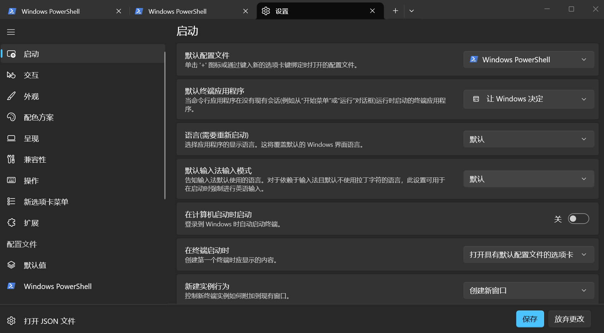
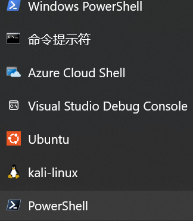

# powershell7安装配置

## 1.安装

```powershell
PS C:\Users\lilyzero207> winget search --id Microsoft.PowerShell --exact
名称       ID                   版本    源
-----------------------------------------------
PowerShell Microsoft.PowerShell 7.7.0.0 winget
PS C:\Users\lilyzero207> winget install --id Microsoft.PowerShell --source winget
已找到 PowerShell [Microsoft.PowerShell] 版本 7.7.0.0
此应用程序由其所有者授权给你。
Microsoft 对第三方程序包概不负责，也不向第三方程序包授予任何许可证。
已成功验证安装程序哈希
正在启动程序包安装...
  ██████████████████████████████  100%
已成功安装
```

## 2.设置为默认

```
ctrl+,
```



更改为以下powershell



此时仅仅点+启动的是powershell7

win+r启动powershell7使用pwsh

于是可以爽用pwsh了（用于ai和体验一下奇妙补全等）